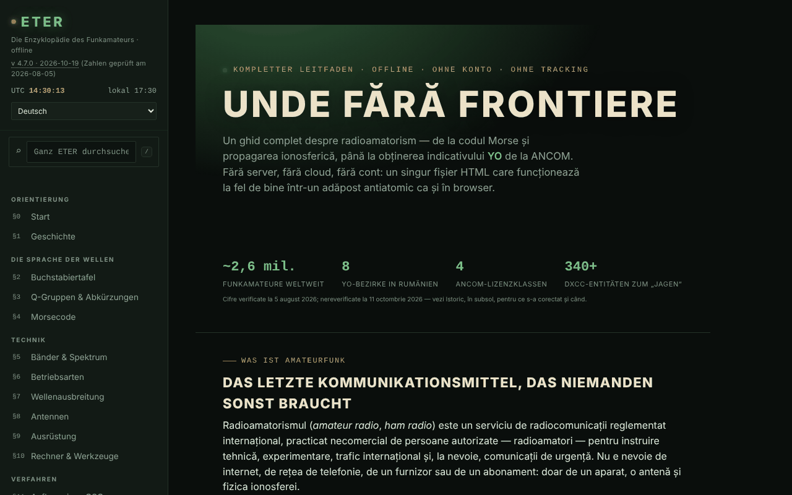

# ETER — Die Enzyklopädie des Funkamateurs

[English](README.md) · [Română](README.ro.md) · [Français](README.fr.md) · [Italiano](README.it.md) · [Español](README.es.md) · [Português](README.pt.md) · **Deutsch** · [Magyar](README.hu.md)

**Version:** 4.7.8 · **Zuletzt aktualisiert:** 2026-10-23

Oberflächensprachen: **Română, English, Français, Italiano, Español, Português (PT), Deutsch, Magyar**

Vollständiger Leitfaden zum Amateurfunk in einer einzigen HTML-Datei: Q-Gruppen, Morsecode, Bänder, Ausbreitung, Antennen, Rufzeichen, ANCOM-Lizenzierung.

**Online-App:** https://chiuta.github.io/ETER/

## Was es ist

ETER ist eine interaktive Enzyklopädie des Funkamateurs (in der App angezeigte Version: v4.7.2, aktualisiert am 2026-10-19; die Zahlen und Vorschriften bleiben die am 2026-08-05 überprüften), gegliedert in 19 nummerierte Abschnitte §0–§18. Der Text in der App beschreibt sie als „ohne Server, ohne Cloud, ohne Konto“, und der Inhalt wird aus derselben HTML-Datei geladen.

**Sprachen:** die Abschnitte des Leitfadens (rund 400 Blöcke), die Q-Gruppen, die Abkürzungen, das Glossar, die Rufzeichenpräfixe und der Fragenkatalog mit Optionen und Erklärungen liegen in den 8 Sprachen vor; Eigennamen, Rufzeichen, Q-Gruppen und Abkürzungen als Symbole, Formeln, Morsezeichen, Namen von Contesten/Diplomen/Diensten, URLs und der Text der alten Versionsverlaufseinträge (v1.0–v4.0, auf Rumänisch) bleiben unverändert. Die Übersetzungen sind automatisch und nicht von Muttersprachlern geprüft; der Abschnitt „Funkamateur YO werden“ (ANCOM-Verfahren, Klassen, Beschluss 245/2017, Fristen, Gebühren), die Quizfragen zu den Vorschriften, der Abschnitt zu Notfunk und Gemeinwohl (ARES/RACES, Relais, NVIS) und die Sicherheitsinhalte (Antennen/HF, Dummy Load, Höchstleistung) **müssen fachlich bzw. juristisch geprüft werden**.

## Funktionen

Abschnitte (Menü links, ☰ auf Mobilgeräten): Startseite, Geschichte, Buchstabieralphabet, Q-Gruppen & Abkürzungen, Morsecode, Bänder & Spektrum, Betriebsarten, Ausbreitung, Antennen, Ausrüstung, Rechner & Werkzeuge, Aufbau eines QSO, Rufzeichen, QSL & Stationslogbuch, Contests & Diplome, Notfälle & öffentliche Aufgaben, Funkamateur YO werden, Wissenstest, Glossar A–Z.

Im Code / in der Oberfläche überprüfte Werkzeuge:
- Morsecode: Übersetzer Text ⇄ Morse mit Audiowiedergabe, Morse-Hörer über das Mikrofon (als experimentell gekennzeichnet), Koch-Trainer (Runden zu 25 Zeichen), Geben-Trainer mit einfacher Taste; Export/Import der Stufe.
- Rechner: Antennenlängen, Maidenhead-Locator (mit „Meinen Standort verwenden“), Azimut und Entfernung (mit Live-Kompass und AR-Kameraüberlagerung, beide optional), Frequenz ⇄ Wellenlänge, S-Meter-/dB-Referenz.
- Didaktischer Simulator von Ausbreitungstrends mit erläuterten Sonnenindizes (SFI, K-Index).
- Wissenstest mit verteilter Wiederholung; Export/Import des Fortschritts, der Identität und eines Ersatzpakets; Erzeugung und Prüfung eines Operator-Zertifikats (QR-Code).
- Globale Suche im linken Menü (Taste `/` oder das Feld „Im gesamten ETER suchen“): findet Abschnitte, Titel von Unterabschnitten, Q-Gruppen, Abkürzungen, Glossarbegriffe und DX-Präfixe, ignoriert Diakritika; Enter öffnet das erste Ergebnis, die Pfeiltasten navigieren durch die Liste, Esc leert das Feld. Auf Mobilgeräten öffnet `/` das Menü.
- Tag-/Nachtmodus, Drucken des aktuellen Abschnitts, Übungsmodus im Vollbild, „Kopieren“-Schaltflächen.
- „Dateiintegrität prüfen“ (SHA-256) und „Woraus die Datei besteht“.
- „Fehler melden“: öffnet das GitHub-Issues-Formular.

## Neue Funktionen (v4.5.0, 14. Oktober 2026)

### Morse-Hörer über das Mikrofon, Version 2 (§4)

Er bleibt **experimentell**, aber jetzt gilt:
- **Tonerkennung** (Standard, Kontrollkästchen „Erkennung per Ton“): Sie findet die Tonfrequenz im Band 300–1500 Hz selbst (eine schmale Spitze im Spektrum, laufend nachgeführt) und misst ihre Amplitude mit einem Goertzel-Filter auf Fenstern von ~12 ms mit einer Schrittweite von ~2,5 ms; sie ignoriert Breitbandrauschen und Sprache (die Energie muss im Ton konzentriert sein) und verwendet eine Hysterese gegenüber dem Tonpegel. Bei abgewähltem Kästchen bleibt die alte Methode (RMS-Pegel gegenüber einer Schwelle) erhalten.
- **Automatische Geschwindigkeit** (Kontrollkästchen „Automatische Geschwindigkeit“): Die Zeiteinheit (Dit) wird aus dem gehörten Rhythmus auf lokalen Fenstern von 13 Zeichen geschätzt, wobei Ausreißer ausgeschlossen werden; der WPM-Regler bleibt nur Ausgangspunkt. Die Code-Dekodierung wird bei jedem neuen Zeichen neu durchgeführt, ein falscher Anfang korrigiert sich also selbst. Anzeige: Tonfrequenz, geschätzte Geschwindigkeit (WPM) und Anzahl der Zeichen.
- Das Mikrofon wird **ohne** Rauschunterdrückung, Echounterdrückung und automatische Verstärkungsregelung angefordert (diese verfälschen reine Töne); die Zeiten werden aus der Anzahl der Audio-Samples berechnet (ScriptProcessor, Rückfall: AnalyserNode), nicht aus Anzeigeframes.
- Neue Schaltflächen: „Text löschen“ und „Text kopieren“.
- **Tatsächliche Grenzen:** geeignet für etwa 8–25 WPM, einen sauberen und konstanten Ton, einen ruhigen Raum. Bei 30 WPM und mehr oder sehr unregelmäßiger Tastung treten Fehler auf. Die ersten Zeichen nach dem Start können fehlen, solange der Ton „eingefangen“ wird (einige zehn ms). Er ersetzt keinen dedizierten Hardware-/Software-Dekoder; bei hoher CPU-Last kann die Audioaufnahme Samples verlieren. Getestet mit synthetischem Audio (5 Geschwindigkeiten/Frequenzen, Rauschen, unregelmäßiger Rhythmus) über das Fake-Audiogerät von Chromium, nicht mit echten Aussendungen im Äther.

### Prüfungsmodus (§17 Wissenstest)

Die Schaltfläche „Prüfungsmodus“ startet eine **Übungs**simulation: 10, 20 oder 30 Fragen aus der vorhandenen Bank (unter Beachtung des Kategoriefilters), mit einem **optionalen Zeitlimit** (10, 20 oder 30 Minuten; der Zeitgeber beruht auf einer Frist und friert daher nicht ein, wenn der Tab im Hintergrund liegt). Er zeigt unterwegs nicht richtig/falsch an; du kannst zwischen den Fragen navigieren (Pfeile ←/→ oder die Schaltflächen „Zu Frage springen“), die Antworten ändern (Tasten 1–4) und jederzeit beenden (mit Bestätigung, wenn Fragen unbeantwortet bleiben, die als falsch zählen). Am Ende: Punktzahl, Prozentsatz, Aufschlüsselung nach Kategorien und die Liste der Fehler mit Erklärungen. Die gegebenen Antworten speisen die vorhandene **verteilte Wiederholung** (richtig/falsch). **Die 75-%-Schwelle wird von der App für die Übung gewählt; sie ist nicht die offizielle ANCOM-Schwelle**, und das Ergebnis sagt die Note in der echten Prüfung nicht voraus (für den Prüfungssimulator siehe examenyo.net und die App INDICATIV).

### Transparenz und Sicherung (fff-kit)

Ein Klick (oder Enter) auf die angezeigte Version (`v 4.5.0 · 2026-10-14`) öffnet das Fenster „Transparenz“: die deklarierten Netzwerk-Hosts (0 externe Anfragen), die Schlüssel des lokalen Speichers mit Größen, die verwendeten APIs, Größe und SHA-256 der Datei (mit einem Prüfer für eine heruntergeladene Datei) und die **Sicherung** der App-Daten in einer `.fff.json`-Datei (optional mit Passwort verschlüsselt, AES-GCM 256 / PBKDF2; das Passwort kann nicht wiederhergestellt werden), Import mit Bestätigung und Löschen der App-Daten. Das Kit (`fff-kit`, Module: core, label, bundle) ist in `index.html` eingebettet, stellt keine Netzwerkanfragen und verändert keine vorhandenen Daten; ohne es funktioniert die App genauso. ETER schreibt nicht selbst in `localStorage`; die Sicherungsdatei des Kits enthält nur etwaige Schlüssel, die das Kit oder eine künftige Version anlegen könnte. Testfortschritt, Koch-Stufe und Identität werden weiterhin über die eigenen Exporte der App gespeichert. Die Texte des Kits liegen in 8 Sprachen vor (ro, en, fr, it, es, pt, hu, de); **die Übersetzungen fr/it/es/pt/hu/de sind automatisch und nicht von Muttersprachlern geprüft**. Oberfläche und Inhalt der App liegen ebenfalls in den 8 Sprachen vor (siehe den Sprachhinweis am Anfang); die Inhaltsübersetzungen sind automatisch und nicht von Muttersprachlern geprüft.

## Anleitung

1. Öffne die Seite und wähle einen Abschnitt im linken Menü (auf Mobilgeräten ☰ drücken).
2. Wechsle im Menü zwischen ☾ Nacht und ☀ Tag.
3. Für Morse: Gib in §4 einen Text in den Übersetzer ein und drücke „Audio abspielen“ („Stop“ hält an); für den Trainer drücke „Runde beginnen“ und „Prüfen“. Die Stufe wird mit „Stufe exportieren“ gespeichert und mit „Stufe importieren“ wieder aufgenommen.
4. Für den Locator: Drücke in §10 „Locator berechnen“ (oder „Meinen Standort verwenden“, was die Berechtigung des Browsers anfordert).
5. Löse in §17 den Test; mit „Fortschritt exportieren“ / „Fortschritt importieren“ behältst du die Ergebnisse zwischen den Sitzungen.
6. Ebenfalls in §17 kannst du ein Operator-Zertifikat erzeugen und später prüfen; „Identität exportieren“ speichert die lokale Identität in einer Datei.
7. „Aktuellen Abschnitt drucken“ druckt den angezeigten Abschnitt; „Fehler melden“ öffnet GitHub Issues.

## Datenschutz und Netzwerk

- Lokal: Ich habe im Code keine Verwendung von `localStorage`, `sessionStorage` oder IndexedDB gefunden. Fortschritt, Stufe und Identität werden nur über Datei-Export/-Import aufbewahrt.
- Netzwerk: Der Text in der App erklärt, dass nichts aus dem Internet geladen wird, und im Code habe ich keine externen Skripte oder Ressourcen gefunden. Die einzigen `fetch`-Aufrufe gehen an die eigene Datei (`location.href`), nur wenn die Seite per URL ausgeliefert wird, für „Dateiintegrität prüfen“ und „Woraus die Datei besteht“.
- Externe Links (ANCOM, QRZ, radioamator.ro, hamradio.ro, IARU R1, examenyo.net, GitHub, trom.tf usw.) öffnen sich nur, wenn du sie anklickst.
- Funktionen, die Browser-Berechtigungen anfordern, nur auf deine Aktion hin: Mikrofon (Morse-Hörer), Standort, Kompass/Ausrichtung und Kamera (AR-Überlagerung, QR-Code-Scan), Sprachsynthese.
- Die Seite hat eine strikte CSP-Richtlinie (`default-src 'none'`; Skripte sind nur per SHA-256-Hash erlaubt, ohne `'unsafe-inline'`; keine Verbindungen zu anderen Domains; nur `self`, `data:` und `blob:`).
- Die App enthält Bibliotheken mit eigenen Lizenzen (z. B. einen QR-Code-Generator, MIT), in die Datei eingebettet.

## Lokal / offline ausführen

Lade `index.html` herunter und öffne sie in einem Browser. Fast alles funktioniert ohne Internet. „Dateiintegrität prüfen“ und „Woraus die Datei besteht“ funktionieren, wenn die Datei per URL ausgeliefert wird (z. B. GitHub Pages); von `file://` (von der Festplatte geöffnet) erlaubt der Browser kein `fetch`, daher bittet dich die App, die Datei `index.html` von der Festplatte auszuwählen, und liest sie nur lokal (ohne Netzwerk). Achtung: Geprüft wird die gewählte Datei, nicht unbedingt die gerade geöffnete Seite.

## Lizenz

MIT — siehe die Datei `LICENSE`. © 2026 Alexandru-Ionuț Chiuță (Alexio). Die in die Datei eingebundenen Drittbibliotheken behalten ihre eigenen Lizenzen (z. B. der QR-Code-Generator von Kazuhiko Arase, MIT).

## Autor

Alexio — Alexandru-Ionuț Chiuță, Kontakt: alexio@trom.tf

## Zusammenfassung

ETER ist eine 8-sprachige Amateurfunk-Enzyklopädie in einer einzigen Datei (19 Abschnitte: Morse-Trainer, Q-Gruppen, Bänder, Ausbreitung, Antennen, Rufzeichen, ANCOM-Lizenzierung, Rechner, Quiz mit verteilter Wiederholung). Sie nutzt keinen Browserspeicher (der Fortschritt wird als Datei exportiert/importiert) und lädt keine externen Ressourcen; externe Links öffnen sich nur per Klick. Die Integritätsprüfung ruft die eigene Datei ab und funktioniert daher nur über eine URL.

## Audit

Audit: 2026-10-10 — geprüft: 0 JS-Fehler; die einzigen `fetch`-Aufrufe gehen an die eigene Datei (`location.href`); im Code gibt es kein `localStorage`/`sessionStorage`/IndexedDB, wie die README erklärt. Der Kontrast der „abgeblendeten“ Farben wurde korrigiert (Nacht- und Tagdesign). Die App hat kein CSP-Meta. Der Inhalt zur ANCOM-Prüfung ist eine didaktische Zusammenfassung, die auf die ANCOM-Entscheidung Nr. 245/2017 als offizielle Quelle verweist; die erzeugten Zertifikate/Micro-Credentials werden weder von der ANCOM noch von irgendeiner Behörde anerkannt (in der App präzisiert, §17).

## Verlauf / Changelog

### 4.7.6 — 2026-10-22

fff-kit 1.1.4: Touch-Ziele und Mindestschriftgröße. Touch-Ziele/Text in der App korrigiert.

### 4.7.5 — 2026-10-22

fff-kit 1.1.2: PBKDF2 mit 600.000 Iterationen, Schutz vor Clickjacking.

- 4.7.4 — 2026-10-22: Mobil: Aller Text hat mindestens 12 px (zuvor an über 150 Stellen 10-11,5 px); Links in der Fußzeile und die Schalter „ältere Versionen“ haben eine größere Tippfläche.
- 4.7.3 — 2026-10-22: **Korrektur**: der Autorenlink in der Fußzeile (TROM — ein Trade-Free-Projekt) ist jetzt in alle Sprachen übersetzt.
### 2026-10-19 (v4.7.1)
- Der gesamte lange Inhalt (rund 400 Leitfadenblöcke, Q-Gruppen, Abkürzungen, Glossar, Präfixe, die 82 Quizfragen mit Erklärungen) ist nach en, fr, it, es, pt, de, hu übersetzt; die Oberfläche der App ist nicht mehr nur auf Rumänisch. Behoben: Lange deutsche Wörter laufen bei 390 px nicht mehr aus den Überschriften.

### 19. Oktober 2026 (v4.6.0)
- Die Adresse `#sec=<id>[&from=<slug>]` öffnet direkt einen Abschnitt der Enzyklopädie (eine andere ID, `quiz` und `morse` werden ignoriert); Links (neuer Tab) zu Alfabete in den Abschnitten „Buchstabieralphabet“ und „Morsecode“. Keine Änderung am regulatorischen Inhalt.

### 14. Oktober 2026 (v4.5.0)
- Morse-Hörer v2: Tonerkennung (Goertzel), automatische Geschwindigkeit, Mikrofon ohne Sprachverarbeitung, Schaltflächen Löschen/Kopieren; Prüfungsmodus im Wissenstest; fff-kit (Transparenz + Sicherung). Der regulatorische Inhalt hat sich nicht geändert.

### 12. Oktober 2026 (v4.4.1)
- 4.4.1 — 2026-10-12: Die Version und das Datum der letzten Aktualisierung werden in der App angezeigt
- Der ANCOM-Inhalt wurde weder geändert noch erneut überprüft.

### 11. Oktober 2026 (v4.4)
- Das Präfix `YO / YP / YQ / YR` (Rumänien) wurde der Präfixliste hinzugefügt (die Suche nach „YO“ ergab 0 Treffer); die Präfixsuche akzeptiert auch ein vollständiges Rufzeichen (z. B. `YO3AIC` → `YO`).
- „Dateiintegrität prüfen“ und „Woraus die Datei besteht“ funktionieren auch von `file://`: Du wählst die Datei von der Festplatte, und der SHA-256 wird lokal berechnet; es wird kein `fetch` mehr von `file://` ausgeführt, sodass der Fehler in der Konsole nicht mehr erscheint.
- Der ANCOM-Inhalt wurde weder geändert noch erneut überprüft.

### 11. Oktober 2026 (v4.3)
- Globale Suche im Menü (Taste `/`): Abschnitte, Titel, Q-Gruppen, Abkürzungen, Glossar, Präfixe.
- CSP: `script-src` per SHA-256-Hash für die drei Skripte anstelle von `'unsafe-inline'`.
- Der ANCOM-Inhalt wurde weder geändert noch erneut überprüft.

### 11. Oktober 2026 (v4.2)
- Die mobile Leiste ist jetzt ein `header`-Landmark; die Hauptüberschrift (h1) existiert in allen Abschnitten, und die Überschriften in der Fußzeile sind h2 (axe: 0 Verstöße, alle Abschnitte bei 1280 und 360 px geprüft).
- Die Beschriftungen scrollbarer Tabellen sind eindeutig (landmark-unique).
- Eine strikte CSP hinzugefügt (`default-src 'none'`).
- Der ANCOM-Inhalt (Zahlen, Prüfungstermine, Entscheidung 245/2017) wurde am 11.10.2026 NICHT erneut überprüft: Er bleibt ausdrücklich als „überprüft am 2026-08-05“ gekennzeichnet; prüfe auf ancom.ro.
