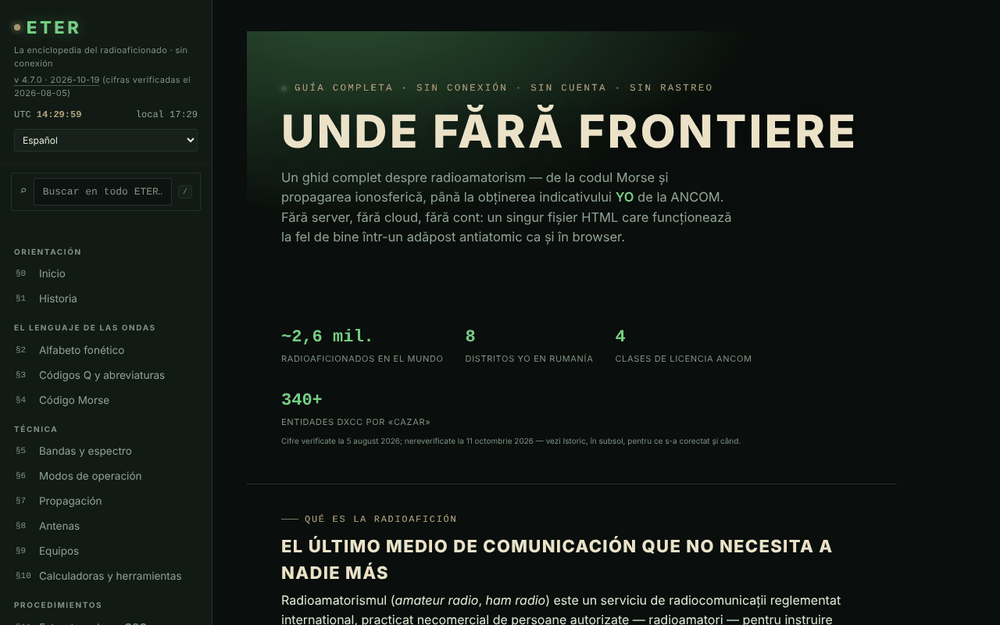

# ETER — La enciclopedia del radioaficionado

[English](README.md) · [Română](README.ro.md) · [Français](README.fr.md) · [Italiano](README.it.md) · **Español** · [Português](README.pt.md) · [Deutsch](README.de.md) · [Magyar](README.hu.md)

**Versión:** 4.7.9 · **Última actualización:** 2026-10-26

Idiomas de la interfaz: **Română, English, Français, Italiano, Español, Português (PT), Deutsch, Magyar**

Guía completa de la radioafición en un único archivo HTML: códigos Q, Morse, bandas, propagación, antenas, indicativos, licencia ANCOM.

**Aplicación en línea:** https://chiuta.github.io/ETER/

## Qué es

ETER es una enciclopedia interactiva del radioaficionado (versión mostrada en la aplicación: v4.7.2, actualizada el 2026-10-19; las cifras y los reglamentos siguen siendo los verificados a 2026-08-05), organizada en 19 secciones numeradas §0–§18. El texto de la aplicación la describe como «sin servidor, sin nube, sin cuenta», y el contenido se carga desde el mismo archivo HTML.

**Idiomas:** las secciones de la guía (unos 400 bloques), los códigos Q, las abreviaturas, el glosario, los prefijos de indicativos y el banco de preguntas con opciones y explicaciones están disponibles en los 8 idiomas; los nombres propios, los indicativos, los códigos Q y abreviaturas como símbolos, las fórmulas, los símbolos Morse, los nombres de concursos/diplomas/servicios, las URL y el cuerpo de las entradas antiguas del historial (v1.0–v4.0, en rumano) permanecen sin cambios. Las traducciones son automáticas, no verificadas por hablantes nativos; la sección «Hazte radioaficionado YO» (procedimiento ANCOM, clases, Decisión 245/2017, plazos, tasas), las preguntas del cuestionario sobre normativa, la sección de emergencias y utilidad pública (ARES/RACES, repetidores, NVIS) y el contenido de seguridad (antenas/RF, carga ficticia, potencia máxima) **requieren revisión especializada o jurídica**.

## Funciones

Secciones (menú de la izquierda, ☰ en móvil): Inicio, Historia, Alfabeto fonético, Códigos Q y abreviaturas, Código Morse, Bandas y espectro, Modos de operación, Propagación, Antenas, Equipos, Calculadoras y herramientas, Estructura de un QSO, Indicativos de llamada, QSL y diario de tráfico, Concursos y diplomas, Emergencias y utilidad pública, Hazte radioaficionado YO, Prueba de conocimientos, Glosario A–Z.

Herramientas verificadas en el código / la interfaz:
- Código Morse: traductor texto ⇄ Morse con reproducción de audio, escucha de Morse desde el micrófono (marcada como experimental), entrenador Koch (rondas de 25 caracteres), entrenador de envío con manipulador simple; exportación/importación del nivel.
- Calculadoras: longitudes de antena, locator Maidenhead (con «Usar mi ubicación»), acimut y distancia (con brújula en vivo y superposición AR de la cámara, ambas opcionales), frecuencia ⇄ longitud de onda, referencia S-metro / dB.
- Simulador didáctico de tendencias de propagación, con explicación de los índices solares (SFI, índice K).
- Prueba de conocimientos con repetición espaciada; exportación/importación del progreso, de la identidad y de un paquete de reserva; generación y verificación de un certificado de operador (código QR).
- Búsqueda global en el menú de la izquierda (tecla `/`, o el campo «Buscar en todo ETER»): encuentra secciones, títulos de subsecciones, códigos Q, abreviaturas, términos del glosario y prefijos DX, ignora los diacríticos; Intro abre el primer resultado, las flechas recorren la lista, Esc vacía el campo. En móvil, `/` abre el menú.
- Modo día / noche, impresión de la sección actual, modo de práctica a pantalla completa, botones «copiar».
- «Verificar la integridad del archivo» (SHA-256) y «De qué está hecho el archivo».
- «Informar de un error»: abre el formulario de GitHub Issues.

## Novedades (v4.5.0, 14 de octubre de 2026)

### Escucha de Morse desde el micrófono, versión 2 (§4)

Sigue siendo **experimental**, pero ahora:
- **Detección de tono** (por defecto, casilla «Detección por tono»): busca por sí sola la frecuencia del tono en la banda de 300–1500 Hz (un pico estrecho en el espectro, seguido sobre la marcha) y mide su amplitud con un filtro de Goertzel en ventanas de ~12 ms, con un paso de ~2,5 ms; ignora el ruido de banda ancha y la voz (la energía debe estar concentrada en el tono) y usa histéresis respecto al nivel del tono. Con la casilla desmarcada se mantiene el método antiguo (nivel RMS frente a un umbral).
- **Velocidad automática** (casilla «Velocidad automática»): la unidad de tiempo (punto) se estima a partir del ritmo escuchado, en ventanas locales de 13 signos, excluyendo los valores atípicos; el control deslizante de WPM queda solo como punto de partida. La decodificación del código se rehace con cada signo nuevo, de modo que un comienzo erróneo se corrige solo. Pantalla: frecuencia del tono, velocidad estimada (WPM) y número de signos.
- El micrófono se solicita **sin** supresión de ruido, cancelación de eco ni control automático de ganancia (que estropean los tonos puros); los tiempos se calculan a partir del número de muestras de audio (ScriptProcessor, alternativa: AnalyserNode), no de los fotogramas de visualización.
- Botones nuevos: «Borrar el texto» y «Copiar el texto».
- **Límites reales:** es adecuado para aproximadamente 8–25 WPM, con un tono limpio y constante, en una sala tranquila. A 30 WPM o más, o con una manipulación muy irregular, aparecen errores. Los primeros signos tras el arranque pueden faltar mientras se «engancha» el tono (decenas de ms). No sustituye a un decodificador dedicado de hardware/software; con una carga elevada de la CPU, la captura de audio puede perder muestras. Probado con audio sintético (5 velocidades/frecuencias, ruido, ritmo irregular) mediante el dispositivo de audio falso de Chromium, no con emisiones reales en el aire.

### Modo examen (§17 Prueba de conocimientos)

El botón «Modo examen» inicia una simulación de **práctica**: 10, 20 o 30 preguntas del banco existente (respetando el filtro de categoría), con un **límite de tiempo opcional** (10, 20 o 30 minutos; el cronómetro se basa en una fecha límite, por lo que no se congela con la pestaña en segundo plano). No muestra correcto/incorrecto sobre la marcha; puedes moverte entre las preguntas (flechas ←/→ o los botones «Saltar a la pregunta»), cambiar las respuestas (teclas 1–4) y terminar en cualquier momento (con confirmación si quedan preguntas sin responder, que cuentan como incorrectas). Al final: puntuación, porcentaje, desglose por categorías y lista de errores con explicaciones. Las respuestas dadas alimentan la **repetición espaciada** existente (correcto/incorrecto). **El umbral del 75 % lo elige la aplicación para practicar; no es el umbral oficial de ANCOM** y el resultado no predice la nota en el examen real (para el simulador de examen véase examenyo.net y la aplicación INDICATIV).

### Transparencia y copia de seguridad (fff-kit)

Un clic (o Intro) en la versión mostrada (`v 4.5.0 · 2026-10-14`) abre la ventana «Transparencia»: los hosts de red declarados (0 solicitudes externas), las claves de almacenamiento local con sus tamaños, las API utilizadas, el tamaño y el SHA-256 del archivo (con un verificador para un archivo descargado) y la **copia de seguridad** de los datos de la aplicación en un archivo `.fff.json` (opcionalmente cifrado con contraseña, AES-GCM 256 / PBKDF2; la contraseña no se puede recuperar), la importación con confirmación y el borrado de los datos de la aplicación. El kit (`fff-kit`, módulos: core, label, bundle) está integrado en `index.html`, no realiza solicitudes de red y no modifica los datos existentes; sin él, la aplicación funciona igual. ETER no escribe por sí misma en `localStorage`; el archivo de copia de seguridad del kit contendrá solo las posibles claves que el kit o una versión futura pudieran crear. El progreso de la prueba, el nivel Koch y la identidad se siguen guardando mediante las exportaciones propias de la aplicación. Los textos del kit están en 8 idiomas (ro, en, fr, it, es, pt, hu, de); **las traducciones fr/it/es/pt/hu/de son automáticas y no han sido verificadas por hablantes nativos**. La interfaz y el contenido de la aplicación también están disponibles en los 8 idiomas (véase la nota sobre idiomas al principio); las traducciones del contenido son automáticas, no verificadas por hablantes nativos.

## Guía de uso

1. Abre la página y elige una sección en el menú de la izquierda (en móvil pulsa ☰).
2. Cambia entre ☾ Noche y ☀ Día desde el menú.
3. Para el Morse: en el §4 escribe un texto en el traductor y pulsa «Reproducir audio» («Stop» lo detiene); para el entrenador pulsa «Empezar una ronda» y «Comprobar». El nivel se guarda con «Exportar el nivel» y se recupera con «Importar el nivel».
4. Para el locator: en el §10 pulsa «Calcular el locator» (o «Usar mi ubicación», que pide el permiso del navegador).
5. En el §17 resuelve la prueba; con «Exportar el progreso» / «Importar el progreso» conservas los resultados entre sesiones.
6. También en el §17 puedes generar un certificado de operador y verificarlo después; «Exportar la identidad» guarda la identidad local en un archivo.
7. «Imprimir la sección actual» imprime la sección mostrada; «Informar de un error» abre GitHub Issues.

## Privacidad y red

- Local: no he encontrado ningún uso de `localStorage`, `sessionStorage` ni IndexedDB en el código. El progreso, el nivel y la identidad solo se conservan mediante exportación/importación de archivos.
- Red: el texto de la aplicación afirma que no se carga nada de internet, y en el código no he encontrado scripts ni recursos externos. Las únicas llamadas `fetch` son a su propio archivo (`location.href`), solo cuando la página se sirve por URL, para «Verificar la integridad del archivo» y «De qué está hecho el archivo».
- Los enlaces externos (ANCOM, QRZ, radioamator.ro, hamradio.ro, IARU R1, examenyo.net, GitHub, trom.tf, etc.) solo se abren si los pulsas.
- Funciones que piden permisos del navegador, solo por acción tuya: micrófono (escucha de Morse), ubicación, brújula/orientación y cámara (superposición AR, escaneo de códigos QR), síntesis de voz.
- La página tiene una política CSP estricta (`default-src 'none'`; los scripts solo se permiten por hash SHA-256, sin `'unsafe-inline'`; sin conexiones a otros dominios; solo `self`, `data:` y `blob:`).
- La aplicación incluye bibliotecas con licencias propias (por ejemplo un generador de códigos QR, MIT), integradas en el archivo.

## Ejecución local / sin conexión

Descarga `index.html` y ábrelo en un navegador. Casi todo funciona sin internet. «Verificar la integridad del archivo» y «De qué está hecho el archivo» funcionan cuando el archivo se sirve por URL (por ejemplo GitHub Pages); desde `file://` (abierto desde el disco) el navegador no permite `fetch`, así que la aplicación te pide que elijas el archivo `index.html` del disco y lo lee solo en local (sin red). Atención: se verifica el archivo elegido, no necesariamente la página abierta en este momento.

## Licencia

MIT — véase el archivo `LICENSE`. © 2026 Alexandru-Ionuț Chiuță (Alexio). Las bibliotecas de terceros incluidas en el archivo conservan sus propias licencias (por ejemplo el generador de códigos QR de Kazuhiko Arase, MIT).

## Autor

Alexio — Alexandru-Ionuț Chiuță, contacto: alexio@trom.tf

## Resumen

ETER es una enciclopedia de radioafición de un único archivo, en 8 idiomas (19 secciones: entrenadores de Morse, códigos Q, bandas, propagación, antenas, indicativos, licencias ANCOM, calculadoras, cuestionario con repetición espaciada). No usa almacenamiento del navegador (el progreso se exporta/importa como archivos) y no carga recursos externos; los enlaces externos se abren solo al hacer clic. La comprobación de integridad obtiene su propio archivo, por lo que solo funciona a través de una URL.

## Auditoría

Auditoría: 2026-10-10 — verificado: 0 errores de JS; los únicos `fetch` son a su propio archivo (`location.href`); no hay `localStorage`/`sessionStorage`/IndexedDB en el código, como afirma el README. Corregido el contraste de los colores «atenuados» (temas noche y día). La aplicación no tiene meta CSP. El contenido sobre el examen de ANCOM es un resumen didáctico que remite a la Decisión de ANCOM n.º 245/2017 como fuente oficial; los certificados/microcredenciales generados no están reconocidos por ANCOM ni por ninguna autoridad (precisado en la aplicación, §17).

## Historial / Changelog

### 4.7.6 — 2026-10-22

fff-kit 1.1.4: áreas táctiles y texto mínimo. Áreas táctiles/texto corregidos en la aplicación.

### 4.7.5 — 2026-10-22

fff-kit 1.1.2: PBKDF2 con 600.000 iteraciones, protección anti-clickjacking.

- 4.7.4 — 2026-10-22: Móvil: todo el texto pasa a un mínimo de 12 px (estaba en 10-11,5 px en más de 150 sitios); los enlaces del pie y los conmutadores «versiones anteriores» tienen un área táctil mayor.
- 4.7.3 — 2026-10-22: **corrección**: el enlace del autor en el pie de página (TROM — proyecto trade-free) ya está traducido a todos los idiomas.
### 2026-10-19 (v4.7.1)
- Todo el contenido largo (unos 400 bloques de guía, códigos Q, abreviaturas, glosario, prefijos, las 82 preguntas del cuestionario con explicaciones) está traducido a en, fr, it, es, pt, de, hu; la interfaz de la aplicación ya no está solo en rumano. Corregido: las palabras alemanas largas ya no desbordan los títulos a 390 px.

### 19 de octubre de 2026 (v4.6.0)
- La dirección `#sec=<id>[&from=<slug>]` abre directamente una sección de la enciclopedia (otro id, `quiz` y `morse` se ignoran); enlaces (pestaña nueva) a Alfabete en las secciones «Alfabeto fonético» y «Código Morse». Ningún cambio en el contenido normativo.

### 14 de octubre de 2026 (v4.5.0)
- Escucha de Morse v2: detección de tono (Goertzel), velocidad automática, micrófono sin procesamiento de voz, botones Borrar/Copiar; modo examen en la Prueba de conocimientos; fff-kit (Transparencia + copia de seguridad). El contenido normativo no cambió.

### 12 de octubre de 2026 (v4.4.1)
- 4.4.1 — 2026-10-12: la versión y la fecha de la última actualización se muestran en la aplicación
- El contenido de ANCOM no se modificó ni se volvió a verificar.

### 11 de octubre de 2026 (v4.4)
- El prefijo `YO / YP / YQ / YR` (Rumanía) se añadió a la lista de prefijos (la búsqueda de «YO» daba 0 resultados); la búsqueda de prefijos acepta también un indicativo completo (p. ej. `YO3AIC` → `YO`).
- «Verificar la integridad del archivo» y «De qué está hecho el archivo» funcionan también desde `file://`: eliges el archivo del disco y el SHA-256 se calcula en local; ya no se hace `fetch` desde `file://`, por lo que no aparece el error en la consola.
- El contenido de ANCOM no se modificó ni se volvió a verificar.

### 11 de octubre de 2026 (v4.3)
- Búsqueda global en el menú (tecla `/`): secciones, títulos, códigos Q, abreviaturas, glosario, prefijos.
- CSP: `script-src` con hash SHA-256 para los tres scripts, en lugar de `'unsafe-inline'`.
- El contenido de ANCOM no se modificó ni se volvió a verificar.

### 11 de octubre de 2026 (v4.2)
- La barra móvil es ahora un punto de referencia `header`; el título principal (h1) existe en todas las secciones, y los títulos del pie son h2 (axe: 0 infracciones, todas las secciones verificadas a 1280 y 360 px).
- Las etiquetas de las tablas desplazables son únicas (landmark-unique).
- Añadida una CSP estricta (`default-src 'none'`).
- El contenido de ANCOM (cifras, convocatorias de examen, Decisión 245/2017) NO se volvió a verificar el 11.10.2026: sigue marcado explícitamente como «verificado a 2026-08-05»; comprueba en ancom.ro.
