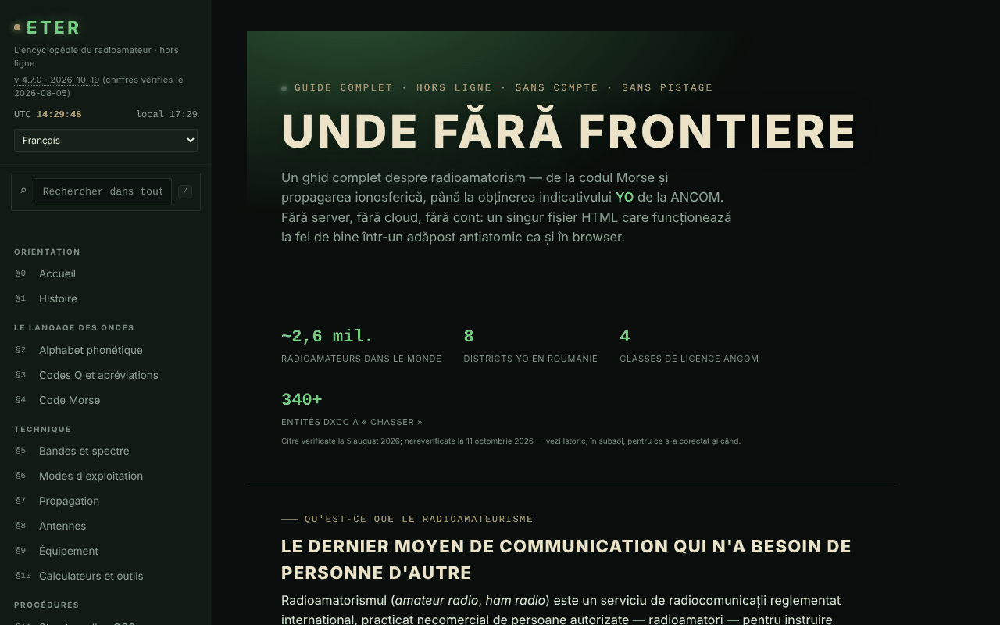

# ETER — L'encyclopédie du radioamateur

[English](README.md) · [Română](README.ro.md) · **Français** · [Italiano](README.it.md) · [Español](README.es.md) · [Português](README.pt.md) · [Deutsch](README.de.md) · [Magyar](README.hu.md)

**Version :** 4.7.2 · **Dernière mise à jour :** 2026-10-19

Langues de l'interface : **Română, English, Français, Italiano, Español, Português (PT), Deutsch, Magyar**

Guide complet du radioamateurisme dans un seul fichier HTML : codes Q, Morse, bandes, propagation, antennes, indicatifs, licence ANCOM.

**Application en ligne :** https://chiuta.github.io/ETER/

## De quoi s'agit-il

ETER est une encyclopédie interactive du radioamateur (version affichée dans l'application : v4.7.2, mise à jour le 2026-10-19 ; les chiffres et les réglementations restent ceux vérifiés au 2026-08-05), organisée en 19 sections numérotées §0–§18. Le texte de l'application la décrit comme « sans serveur, sans cloud, sans compte », et le contenu se charge depuis le même fichier HTML.

**Langues :** les sections du guide (environ 400 blocs), les codes Q, les abréviations, le glossaire, les préfixes d'indicatifs et la banque de questions avec options et explications sont disponibles dans les 8 langues ; les noms propres, les indicatifs, les codes Q et abréviations comme symboles, les formules, les symboles Morse, les noms de concours/diplômes/services, les URL et le corps des anciennes entrées de l'historique (v1.0–v4.0, en roumain) restent tels quels. Les traductions sont automatiques, non vérifiées par des locuteurs natifs ; la section « Devenir radioamateur YO » (procédure ANCOM, classes, décision 245/2017, délais, taxes), les questions de quiz sur la réglementation, la section urgences et utilité publique (ARES/RACES, relais, NVIS) et le contenu de sécurité (antennes/RF, charge fictive, puissance maximale) **doivent être relus par un spécialiste ou un juriste**.

## Fonctionnalités

Sections (menu de gauche, ☰ sur mobile) : Accueil, Histoire, Alphabet phonétique, Codes Q et abréviations, Code Morse, Bandes et spectre, Modes d'exploitation, Propagation, Antennes, Équipements, Calculateurs et outils, Structure d'un QSO, Indicatifs d'appel, QSL et journal de trafic, Concours et diplômes, Urgences et utilité publique, Devenir radioamateur YO, Test de connaissances, Glossaire A–Z.

Outils vérifiés dans le code / l'interface :
- Code Morse : traducteur texte ⇄ Morse avec lecture audio, écoute du Morse au microphone (marquée expérimentale), entraîneur Koch (séries de 25 caractères), entraîneur d'émission avec manipulateur simple ; export/import du niveau.
- Calculateurs : longueurs d'antenne, locator Maidenhead (avec « Utiliser ma position »), azimut et distance (avec boussole en direct et surimpression AR de la caméra, tous deux facultatifs), fréquence ⇄ longueur d'onde, référence S-mètre / dB.
- Simulateur didactique des tendances de propagation, avec explication des indices solaires (SFI, indice K).
- Test de connaissances avec répétition espacée ; export/import de la progression, de l'identité et d'un paquet de secours ; génération et vérification d'un certificat d'opérateur (code QR).
- Recherche globale dans le menu de gauche (touche `/`, ou champ « Rechercher dans tout ETER ») : trouve des sections, des titres de sous-sections, des codes Q, des abréviations, des termes du glossaire et des préfixes DX, ignore les diacritiques ; Entrée ouvre le premier résultat, les flèches naviguent dans la liste, Échap vide le champ. Sur mobile, `/` ouvre le menu.
- Mode jour / nuit, impression de la section courante, mode d'entraînement en plein écran, boutons « copier ».
- « Vérifier l'intégrité du fichier » (SHA-256) et « De quoi est fait le fichier ».
- « Signaler une erreur » : ouvre le formulaire GitHub Issues.

## Nouveautés (v4.5.0, 14 octobre 2026)

### Écoute du Morse au microphone, version 2 (§4)

Elle reste **expérimentale**, mais désormais :
- **Détection de tonalité** (par défaut, case « Détection par tonalité ») : elle trouve seule la fréquence de la tonalité dans la bande 300–1500 Hz (un pic étroit dans le spectre, suivi au fil du temps) et mesure son amplitude avec un filtre de Goertzel sur des fenêtres d'environ 12 ms, avec un pas d'environ 2,5 ms ; elle ignore le bruit large bande et la parole (l'énergie doit être concentrée dans la tonalité) et utilise une hystérésis par rapport au niveau de la tonalité. Case décochée, l'ancienne méthode est conservée (niveau RMS par rapport à un seuil).
- **Vitesse automatique** (case « Vitesse automatique ») : l'unité de temps (le point) est estimée d'après le rythme entendu, sur des fenêtres locales de 13 signes, en excluant les valeurs aberrantes ; le curseur WPM n'est plus qu'un point de départ. Le décodage du code est refait à chaque nouveau signe, de sorte qu'un mauvais début se corrige de lui-même. Affichage : fréquence de la tonalité, vitesse estimée (WPM) et nombre de signes.
- Le microphone est demandé **sans** suppression de bruit, annulation d'écho et contrôle automatique de gain (ceux-ci détériorent les tonalités pures) ; les durées sont calculées d'après le nombre d'échantillons audio (ScriptProcessor, repli : AnalyserNode), et non d'après les images d'affichage.
- Nouveaux boutons : « Effacer le texte » et « Copier le texte ».
- **Limites réelles :** convient à environ 8–25 WPM, avec une tonalité propre et constante, dans une pièce calme. À 30 WPM et au-delà, ou avec une manipulation très irrégulière, des erreurs apparaissent. Les premiers signes après le démarrage peuvent manquer le temps que la tonalité soit « accrochée » (quelques dizaines de ms). Cela ne remplace pas un décodeur matériel/logiciel dédié ; sous forte charge du processeur, l'enregistrement audio peut perdre des échantillons. Testé avec de l'audio synthétique (5 vitesses/fréquences, bruit, rythme irrégulier) via le périphérique audio factice de Chromium, et non avec de vraies émissions sur l'air.

### Mode examen (§17 Test de connaissances)

Le bouton « Mode examen » lance une simulation d'**entraînement** : 10, 20 ou 30 questions tirées de la banque existante (en respectant le filtre de catégorie), avec une **limite de temps facultative** (10, 20 ou 30 minutes ; le chronomètre repose sur une échéance, il ne se fige donc pas lorsque l'onglet est en arrière-plan). Il n'indique pas correct/faux en cours de route ; vous pouvez naviguer entre les questions (flèches ←/→ ou boutons « Aller à la question »), modifier vos réponses (touches 1–4) et terminer à tout moment (avec confirmation s'il reste des questions sans réponse, qui comptent comme fausses). À la fin : score, pourcentage, détail par catégories et liste des erreurs avec explications. Les réponses données alimentent la **répétition espacée** existante (correct/faux). **Le seuil de 75 % est choisi par l'application pour l'entraînement ; ce n'est pas le seuil officiel de l'ANCOM** et le résultat ne prédit pas la note à l'examen réel (pour le simulateur d'examen, voir examenyo.net et l'application INDICATIV).

### Transparence et sauvegarde (fff-kit)

Un clic (ou Entrée) sur la version affichée (`v 4.5.0 · 2026-10-14`) ouvre la fenêtre « Transparence » : les hôtes réseau déclarés (0 requête externe), les clés de stockage local avec leur taille, les API utilisées, la taille et le SHA-256 du fichier (avec un vérificateur pour un fichier téléchargé) et la **sauvegarde** des données de l'application dans un fichier `.fff.json` (éventuellement chiffré par mot de passe, AES-GCM 256 / PBKDF2 ; le mot de passe est irrécupérable), l'import avec confirmation et la suppression des données de l'application. Le kit (`fff-kit`, modules : core, label, bundle) est intégré dans `index.html`, ne fait aucune requête réseau et ne modifie pas les données existantes ; sans lui, l'application fonctionne de la même façon. ETER n'écrit pas lui-même dans `localStorage` ; le fichier de sauvegarde du kit ne contiendra que les éventuelles clés que le kit ou une version future pourrait créer. La progression du test, le niveau Koch et l'identité continuent d'être enregistrés via les exports propres de l'application. Les textes du kit existent en 8 langues (ro, en, fr, it, es, pt, hu, de) ; **les traductions fr/it/es/pt/hu/de sont automatiques et non vérifiées par des locuteurs natifs**. L'interface et le contenu de l'application sont aussi disponibles dans les 8 langues (voir la note sur les langues en haut) ; les traductions du contenu sont automatiques, non vérifiées par des locuteurs natifs.

## Mode d'emploi

1. Ouvrez la page et choisissez une section dans le menu de gauche (sur mobile, appuyez sur ☰).
2. Basculez entre ☾ Nuit et ☀ Jour depuis le menu.
3. Pour le Morse : au §4, saisissez un texte dans le traducteur et appuyez sur « Lire l'audio » (« Stop » l'arrête) ; pour l'entraîneur, appuyez sur « Commencer une série » et « Vérifier ». Le niveau s'enregistre avec « Exporter le niveau » et se reprend avec « Importer le niveau ».
4. Pour le locator : au §10, appuyez sur « Calculer le locator » (ou « Utiliser ma position », qui demande l'autorisation du navigateur).
5. Au §17, passez le test ; avec « Exporter la progression » / « Importer la progression », vous conservez les résultats d'une session à l'autre.
6. Toujours au §17, vous pouvez générer un certificat d'opérateur et le vérifier ensuite ; « Exporter l'identité » enregistre l'identité locale dans un fichier.
7. « Imprimer la section courante » imprime la section affichée ; « Signaler une erreur » ouvre GitHub Issues.

## Confidentialité et réseau

- Local : je n'ai trouvé aucun usage de `localStorage`, `sessionStorage` ou IndexedDB dans le code. La progression, le niveau et l'identité ne sont conservés que par export/import de fichiers.
- Réseau : le texte de l'application affirme que rien n'est chargé depuis Internet, et dans le code je n'ai trouvé ni scripts ni ressources externes. Les seuls appels `fetch` visent son propre fichier (`location.href`), uniquement lorsque la page est servie par URL, pour « Vérifier l'intégrité du fichier » et « De quoi est fait le fichier ».
- Les liens externes (ANCOM, QRZ, radioamator.ro, hamradio.ro, IARU R1, examenyo.net, GitHub, trom.tf, etc.) ne s'ouvrent que si vous cliquez dessus.
- Fonctions qui demandent des autorisations du navigateur, uniquement à votre action : microphone (écoute du Morse), localisation, boussole/orientation et caméra (surimpression AR, lecture de codes QR), synthèse vocale.
- La page a une politique CSP stricte (`default-src 'none'` ; les scripts ne sont autorisés que par hachage SHA-256, sans `'unsafe-inline'` ; pas de connexions vers d'autres domaines ; seulement `self`, `data:` et `blob:`).
- L'application inclut des bibliothèques sous leurs propres licences (par exemple un générateur de codes QR, MIT), intégrées dans le fichier.

## Exécution locale / hors ligne

Téléchargez `index.html` et ouvrez-le dans un navigateur. Presque tout fonctionne sans Internet. « Vérifier l'intégrité du fichier » et « De quoi est fait le fichier » fonctionnent lorsque le fichier est servi par URL (par exemple GitHub Pages) ; depuis `file://` (ouvert depuis le disque), le navigateur n'autorise pas `fetch`, de sorte que l'application vous demande de choisir le fichier `index.html` sur le disque et le lit uniquement en local (sans réseau). Attention : c'est le fichier choisi qui est vérifié, pas nécessairement la page actuellement ouverte.

## Licence

MIT — voir le fichier `LICENSE`. © 2026 Alexandru-Ionuț Chiuță (Alexio). Les bibliothèques tierces incluses dans le fichier conservent leurs propres licences (par exemple le générateur de codes QR de Kazuhiko Arase, MIT).

## Auteur

Alexio — Alexandru-Ionuț Chiuță, contact : alexio@trom.tf

## Résumé

ETER est une encyclopédie de radioamateurs en 8 langues, en un seul fichier (19 sections : entraîneurs de Morse, codes Q, bandes, propagation, antennes, indicatifs, licences ANCOM, calculateurs, quiz avec répétition espacée). Il n'utilise aucun stockage du navigateur (la progression est exportée/importée sous forme de fichiers) et ne charge aucune ressource externe ; les liens externes ne s'ouvrent qu'au clic. Le contrôle d'intégrité récupère son propre fichier ; il ne fonctionne donc que via une URL.

## Audit

Audit : 2026-10-10 — vérifié : 0 erreur JS ; les seuls `fetch` visent son propre fichier (`location.href`) ; il n'y a ni `localStorage`/`sessionStorage`/IndexedDB dans le code, comme l'affirme le README. Contraste des couleurs « atténuées » corrigé (thèmes nuit et jour). L'application n'a pas de meta CSP. Le contenu relatif à l'examen ANCOM est un résumé didactique qui renvoie à la Décision ANCOM n° 245/2017 comme source officielle ; les certificats/microcertifications générés ne sont reconnus ni par l'ANCOM ni par aucune autorité (précisé dans l'application, §17).

## Historique / Changelog

### 2026-10-19 (v4.7.1)
- Tout le contenu long (environ 400 blocs de guide, codes Q, abréviations, glossaire, préfixes, les 82 questions de quiz avec explications) est traduit en en, fr, it, es, pt, de, hu ; l'interface de l'application n'est plus seulement en roumain. Correction : les longs mots allemands ne débordent plus des titres à 390 px.

### 19 octobre 2026 (v4.6.0)
- L'adresse `#sec=<id>[&from=<slug>]` ouvre directement une section de l'encyclopédie (un autre id, `quiz` et `morse` sont ignorés) ; liens (nouvel onglet) vers Alfabete dans les sections « Alphabet phonétique » et « Code Morse ». Aucun changement du contenu réglementaire.

### 14 octobre 2026 (v4.5.0)
- Écoute du Morse v2 : détection de tonalité (Goertzel), vitesse automatique, microphone sans traitement de la voix, boutons Effacer/Copier ; mode examen dans le Test de connaissances ; fff-kit (Transparence + sauvegarde). Le contenu réglementaire n'a pas changé.

### 12 octobre 2026 (v4.4.1)
- 4.4.1 — 2026-10-12 : la version et la date de la dernière mise à jour sont affichées dans l'application
- Le contenu ANCOM n'a été ni modifié ni revérifié.

### 11 octobre 2026 (v4.4)
- Le préfixe `YO / YP / YQ / YR` (Roumanie) a été ajouté à la liste des préfixes (la recherche « YO » donnait 0 résultat) ; la recherche de préfixes accepte aussi un indicatif entier (p. ex. `YO3AIC` → `YO`).
- « Vérifier l'intégrité du fichier » et « De quoi est fait le fichier » fonctionnent aussi depuis `file://` : vous choisissez le fichier sur le disque et le SHA-256 est calculé localement ; il n'y a plus de `fetch` depuis `file://`, donc l'erreur dans la console n'apparaît plus.
- Le contenu ANCOM n'a été ni modifié ni revérifié.

### 11 octobre 2026 (v4.3)
- Recherche globale dans le menu (touche `/`) : sections, titres, codes Q, abréviations, glossaire, préfixes.
- CSP : `script-src` par hachage SHA-256 pour les trois scripts, à la place de `'unsafe-inline'`.
- Le contenu ANCOM n'a été ni modifié ni revérifié.

### 11 octobre 2026 (v4.2)
- La barre mobile est désormais un repère `header` ; le titre principal (h1) existe dans toutes les sections, et les titres du pied de page sont des h2 (axe : 0 violation, toutes les sections vérifiées à 1280 et 360 px).
- Les étiquettes des tableaux défilants sont uniques (landmark-unique).
- Ajout d'une CSP stricte (`default-src 'none'`).
- Le contenu ANCOM (chiffres, sessions d'examen, Décision 245/2017) n'a PAS été revérifié au 11.10.2026 : il reste explicitement marqué « vérifié au 2026-08-05 » ; vérifiez sur ancom.ro.
