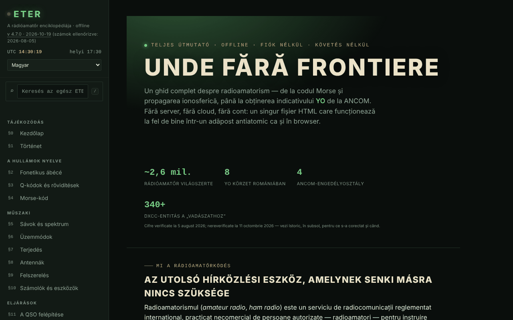

# ETER — A rádióamatőr enciklopédiája

[English](README.md) · [Română](README.ro.md) · [Français](README.fr.md) · [Italiano](README.it.md) · [Español](README.es.md) · [Português](README.pt.md) · [Deutsch](README.de.md) · **Magyar**

**Verzió:** 4.7.1 · **Utolsó frissítés:** 2026-10-19

A felület nyelvei: **Română, English, Français, Italiano, Español, Português (PT), Deutsch, Magyar**

Teljes útmutató a rádióamatőrséghez egyetlen HTML-fájlban: Q-kódok, morze, sávok, terjedés, antennák, hívójelek, ANCOM-engedélyezés.

**Online alkalmazás:** https://chiuta.github.io/ETER/

## Mi ez

Az ETER a rádióamatőr interaktív enciklopédiája (az alkalmazásban megjelenített verzió: v4.4.1, frissítve 2026-10-12-én; a számadatok és a szabályozások a 2026-08-05-én ellenőrzöttek maradnak), 19 számozott szakaszba rendezve: §0–§18. Az alkalmazás szövege „szerver nélkül, felhő nélkül, fiók nélkül” jellemzi, a tartalom pedig ugyanabból a HTML-fájlból töltődik be.

## Funkciók

Szakaszok (bal oldali menü, mobilon ☰): Főoldal, Történelem, Fonetikus ábécé, Q-kódok és rövidítések, Morze-kód, Sávok és spektrum, Üzemmódok, Terjedés, Antennák, Berendezések, Számológépek és eszközök, A QSO felépítése, Hívójelek, QSL és forgalmi napló, Versenyek és oklevelek, Veszélyhelyzetek és közcélú szolgálat, Légy YO rádióamatőr, Tudáspróba, A–Z szószedet.

A kódban / felületen ellenőrzött eszközök:
- Morze-kód: szöveg ⇄ morze fordító hanglejátszással, morze-hallgató a mikrofonról (kísérletiként megjelölve), Koch-gyakorló (25 karakteres körök), adásgyakorló egyszerű billentyűvel; a szint exportálása/importálása.
- Számológépek: antennahosszak, Maidenhead-lokátor (a „Saját helyzetem használata” lehetőséggel), azimut és távolság (élő iránytűvel és kamerás AR-rávetítéssel, mindkettő opcionális), frekvencia ⇄ hullámhossz, S-méter / dB referencia.
- Didaktikai szimulátor a terjedési tendenciákhoz, a naptevékenységi mutatók (SFI, K-index) magyarázatával.
- Tudáspróba térközökkel ismétlő gyakorlással; a haladás, az azonosság és egy tartalék csomag exportálása/importálása; üzemeltetői tanúsítvány előállítása és ellenőrzése (QR-kód).
- Globális keresés a bal oldali menüben (a `/` billentyű, vagy a „Keresés az egész ETER-ben” mező): szakaszokat, alszakaszcímeket, Q-kódokat, rövidítéseket, szószedeti kifejezéseket és DX-előtagokat talál, figyelmen kívül hagyja az ékezeteket; az Enter megnyitja az első találatot, a nyilak a listában navigálnak, az Esc kiüríti a mezőt. Mobilon a `/` megnyitja a menüt.
- Nappali / éjszakai mód, az aktuális szakasz nyomtatása, teljes képernyős gyakorló mód, „másolás” gombok.
- „Fájl épségének ellenőrzése” (SHA-256) és „Miből áll a fájl”.
- „Hiba jelentése”: megnyitja a GitHub Issues űrlapot.

## Újdonságok (v4.5.0, 2026. október 14.)

### Morze-hallgató a mikrofonról, 2. verzió (§4)

Továbbra is **kísérleti**, de most már:
- **Hangfelismerés** (alapértelmezett, a „Felismerés hang alapján” jelölőnégyzet): önállóan megkeresi a hang frekvenciáját a 300–1500 Hz-es sávban (keskeny csúcs a spektrumban, menet közben követve), és Goertzel-szűrővel méri az amplitúdóját ~12 ms-os ablakokon, ~2,5 ms-os lépéssel; figyelmen kívül hagyja a szélessávú zajt és a beszédet (az energiának a hangban kell koncentrálódnia), és hiszterézist alkalmaz a hang szintjéhez képest. A jelölőnégyzet kikapcsolásakor a régi módszer marad (RMS-szint egy küszöbhöz képest).
- **Automatikus sebesség** („Automatikus sebesség” jelölőnégyzet): az időegységet (a pontot) a hallott ritmusból becsüli 13 jeles helyi ablakokon, a kiugró értékek kizárásával; a WPM-csúszka csak kiindulópont marad. A kód megfejtése minden új jelnél újra lefut, így egy hibás kezdet magától kijavítódik. Kijelzés: a hang frekvenciája, a becsült sebesség (WPM) és a jelek száma.
- A mikrofont **zajszűrés, visszhangeltávolítás és automatikus erősítésszabályozás nélkül** kéri (ezek rontják a tiszta hangokat); az időzítéseket a hangminták számából számítja (ScriptProcessor, tartalék: AnalyserNode), nem a megjelenítési képkockákból.
- Új gombok: „Szöveg törlése” és „Szöveg másolása”.
- **Valós korlátok:** nagyjából 8–25 WPM-hez, tiszta és állandó hanghoz, csendes szobához való. 30 WPM és afölött, vagy nagyon szabálytalan billentyűzés esetén hibák jelentkeznek. Az indítás utáni első jelek hiányozhatnak, amíg a hang „befogódik” (néhány tíz ms). Nem helyettesíti a dedikált hardveres/szoftveres dekódert; nagy processzorterhelés alatt a hangfelvétel mintákat veszíthet. Szintetikus hanggal tesztelve (5 sebesség/frekvencia, zaj, szabálytalan ritmus) a Chromium álhangeszközén keresztül, nem valódi éteri adásokkal.

### Vizsgamód (§17 Tudáspróba)

A „Vizsgamód” gomb **gyakorló** szimulációt indít: 10, 20 vagy 30 kérdést a meglévő bankból (a kategóriaszűrőt tiszteletben tartva), **opcionális időkorláttal** (10, 20 vagy 30 perc; az időzítő határidőn alapul, ezért nem fagy le, ha a lap a háttérben van). Menet közben nem mutat helyes/hibás jelzést; kérdések között navigálhatsz (←/→ nyilak vagy az „Ugrás a kérdésre” gombok), módosíthatod a válaszokat (1–4 billentyűk), és bármikor befejezheted (megerősítéssel, ha megválaszolatlan kérdések maradnak, amelyek hibásként számítanak). A végén: pontszám, százalék, kategóriák szerinti bontás és a hibák listája magyarázatokkal. A megadott válaszok a meglévő **térközökkel ismétlő gyakorlást** táplálják (helyes/hibás). **A 75%-os küszöböt az alkalmazás választja a gyakorláshoz; nem az ANCOM hivatalos küszöbe**, és az eredmény nem jósolja meg a jegyet a valódi vizsgán (a vizsgaszimulátorért lásd az examenyo.net oldalt és az INDICATIV alkalmazást).

### Átláthatóság és biztonsági mentés (fff-kit)

A megjelenített verzióra (`v 4.5.0 · 2026-10-14`) kattintva (vagy Entert nyomva) megnyílik az „Átláthatóság” ablak: a deklarált hálózati gazdagépek (0 külső kérés), a helyi tárolás kulcsai méretekkel, a használt API-k, a fájl mérete és SHA-256 értéke (letöltött fájl ellenőrzőjével), valamint az alkalmazás adatainak **biztonsági mentése** egy `.fff.json` fájlba (opcionálisan jelszóval titkosítva, AES-GCM 256 / PBKDF2; a jelszó nem állítható vissza), importálás megerősítéssel és az alkalmazás adatainak törlése. A kit (`fff-kit`, modulok: core, label, bundle) be van ágyazva az `index.html` fájlba, nem végez hálózati kéréseket, és nem módosítja a meglévő adatokat; nélküle az alkalmazás ugyanígy működik. Az ETER maga nem ír a `localStorage`-ba; a kit biztonsági mentési fájlja csak azokat az esetleges kulcsokat fogja tartalmazni, amelyeket a kit vagy egy jövőbeli verzió létrehozhat. A teszt haladása, a Koch-szint és az azonosság továbbra is az alkalmazás saját exportjain keresztül mentődik. A kit szövegei 8 nyelven vannak (ro, en, fr, it, es, pt, hu, de); **az fr/it/es/pt/hu/de fordítások automatikusak, és anyanyelvi beszélők nem ellenőrizték őket**. Maga az alkalmazás felülete román marad.

## Használati útmutató

1. Nyisd meg az oldalt, és válassz szakaszt a bal oldali menüből (mobilon nyomd meg a ☰ gombot).
2. Váltogass a ☾ Éjszaka és a ☀ Nappal között a menüből.
3. A morzéhoz: a §4-ben írj be egy szöveget a fordítóba, és nyomd meg a „Hang lejátszása” gombot (a „Stop” leállítja); a gyakorlóhoz nyomd meg a „Kör indítása” és az „Ellenőrzés” gombot. A szint a „Szint exportálása” gombbal menthető, és a „Szint importálása” gombbal állítható vissza.
4. A lokátorhoz: a §10-ben nyomd meg a „Lokátor kiszámítása” gombot (vagy a „Saját helyzetem használata” gombot, amely a böngésző engedélyét kéri).
5. A §17-ben oldd meg a tesztet; a „Haladás exportálása” / „Haladás importálása” gombbal megőrizheted az eredményeket a munkamenetek között.
6. Szintén a §17-ben előállíthatsz üzemeltetői tanúsítványt, és később ellenőrizheted; az „Azonosság exportálása” a helyi azonosságot fájlba menti.
7. Az „Aktuális szakasz nyomtatása” a megjelenített szakaszt nyomtatja; a „Hiba jelentése” megnyitja a GitHub Issues-t.

## Adatvédelem és hálózat

- Helyi: a kódban nem találtam `localStorage`, `sessionStorage` vagy IndexedDB használatot. A haladás, a szint és az azonosság csak fájl-exportálással/-importálással őrződik meg.
- Hálózat: az alkalmazás szövege szerint semmi sem töltődik be az internetről, és a kódban nem találtam külső szkripteket vagy erőforrásokat. Az egyetlen `fetch` hívások a saját fájlra irányulnak (`location.href`), csak ha az oldal URL-en keresztül van kiszolgálva, a „Fájl épségének ellenőrzése” és a „Miből áll a fájl” funkcióhoz.
- A külső hivatkozások (ANCOM, QRZ, radioamator.ro, hamradio.ro, IARU R1, examenyo.net, GitHub, trom.tf stb.) csak akkor nyílnak meg, ha rájuk kattintasz.
- Böngészőengedélyt kérő funkciók, csak a te műveletedre: mikrofon (morze-hallgató), helyadat, iránytű/tájolás és kamera (AR-rávetítés, QR-kód beolvasása), beszédszintézis.
- Az oldalnak szigorú CSP-szabályzata van (`default-src 'none'`; a szkriptek csak SHA-256 hash alapján engedélyezettek, `'unsafe-inline'` nélkül; nincs kapcsolat más domainekkel; csak `self`, `data:` és `blob:`).
- Az alkalmazás saját licencű könyvtárakat tartalmaz (például QR-kód-generátort, MIT), a fájlba ágyazva.

## Helyi / offline futtatás

Töltsd le az `index.html` fájlt, és nyisd meg egy böngészőben. Szinte minden internet nélkül működik. A „Fájl épségének ellenőrzése” és a „Miből áll a fájl” akkor működik, ha a fájl URL-en keresztül van kiszolgálva (például GitHub Pages); `file://` esetén (lemezről megnyitva) a böngésző nem engedi a `fetch`-et, ezért az alkalmazás megkér, hogy válaszd ki az `index.html` fájlt a lemezről, és csak helyben olvassa be (hálózat nélkül). Figyelem: a kiválasztott fájlt ellenőrzi, nem feltétlenül az éppen megnyitott oldalt.

## Licenc

MIT — lásd a `LICENSE` fájlt. © 2026 Alexandru-Ionuț Chiuță (Alexio). A fájlba foglalt harmadik féltől származó könyvtárak megtartják saját licenceiket (például Kazuhiko Arase QR-kód-generátora, MIT).

## Szerző

Alexio — Alexandru-Ionuț Chiuță, elérhetőség: alexio@trom.tf

## Összefoglaló
Az ETER egyfájlos, román nyelvű rádióamatőr-enciklopédia (19 szakasz: morze-gyakorlók, Q-kódok, sávok, terjedés, antennák, hívójelek, ANCOM-engedélyezés, számológépek, kvíz időzített ismétléssel). Nem használ böngészőtárolót (a haladás fájlként exportálható/importálható), és nem tölt be külső erőforrásokat; a külső hivatkozások csak kattintásra nyílnak meg. Az integritásellenőrzés a saját fájlját kéri le, ezért csak URL-en keresztül működik.

## Audit

Audit: 2026-10-10 — ellenőrizve: 0 JS-hiba; az egyetlen `fetch` hívások a saját fájlra irányulnak (`location.href`); a kódban nincs `localStorage`/`sessionStorage`/IndexedDB, ahogy a README állítja. Kijavítva a „tompított” színek kontrasztja (éjszakai és nappali téma). Az alkalmazásnak nincs CSP meta eleme. Az ANCOM-vizsgára vonatkozó tartalom didaktikai összefoglaló, amely hivatalos forrásként az ANCOM 245/2017. sz. határozatára utal; a létrehozott tanúsítványokat/mikrotanúsítványokat sem az ANCOM, sem semmilyen hatóság nem ismeri el (az alkalmazásban pontosítva, §17).

## Előzmények / Changelog

### 2026. október 19. (v4.6.0)
- A `#sec=<id>[&from=<slug>]` cím közvetlenül megnyitja az enciklopédia egy szakaszát (más azonosító, a `quiz` és a `morse` figyelmen kívül marad); hivatkozások (új lapon) az Alfabete-re a „Fonetikus ábécé” és a „Morze-kód” szakaszokban. A szabályozási tartalom nem változott.

### 2026. október 14. (v4.5.0)
- Morze-hallgató v2: hangfelismerés (Goertzel), automatikus sebesség, mikrofon hangfeldolgozás nélkül, Törlés/Másolás gombok; vizsgamód a Tudáspróbában; fff-kit (Átláthatóság + biztonsági mentés). A szabályozási tartalom nem változott.

### 2026. október 12. (v4.4.1)
- 4.4.1 — 2026-10-12: a verzió és az utolsó frissítés dátuma megjelenik az alkalmazásban
- Az ANCOM-tartalmat nem módosították és nem ellenőrizték újra.

### 2026. október 11. (v4.4)
- A `YO / YP / YQ / YR` előtag (Románia) bekerült az előtaglistába (a „YO” keresése 0 találatot adott); az előtagkeresés teljes hívójelet is elfogad (pl. `YO3AIC` → `YO`).
- A „Fájl épségének ellenőrzése” és a „Miből áll a fájl” `file://` esetén is működik: kiválasztod a fájlt a lemezről, és az SHA-256 helyben számítódik; `file://`-ról már nem történik `fetch`, így a konzolhiba nem jelenik meg.
- Az ANCOM-tartalmat nem módosították és nem ellenőrizték újra.

### 2026. október 11. (v4.3)
- Globális keresés a menüben (a `/` billentyű): szakaszok, címek, Q-kódok, rövidítések, szószedet, előtagok.
- CSP: `script-src` SHA-256 hash alapján a három szkripthez, az `'unsafe-inline'` helyett.
- Az ANCOM-tartalmat nem módosították és nem ellenőrizték újra.

### 2026. október 11. (v4.2)
- A mobil sáv most már `header` tájékozódási pont; a fő címsor (h1) minden szakaszban létezik, a láblécben lévő címsorok pedig h2-k (axe: 0 szabálysértés, minden szakasz ellenőrizve 1280 és 360 px mellett).
- A görgethető táblázatok címkéi egyediek (landmark-unique).
- Szigorú CSP hozzáadva (`default-src 'none'`).
- Az ANCOM-tartalmat (számadatok, vizsgaidőszakok, a 245/2017. sz. határozat) 2026. 10. 11-én NEM ellenőrizték újra: továbbra is kifejezetten „2026-08-05-én ellenőrizve” jelölést visel; ellenőrizd az ancom.ro oldalon.
