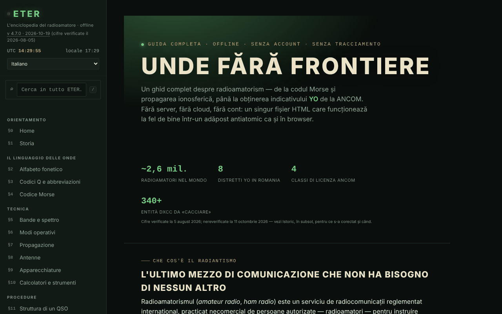

# ETER — L'enciclopedia del radioamatore

[English](README.md) · [Română](README.ro.md) · [Français](README.fr.md) · **Italiano** · [Español](README.es.md) · [Português](README.pt.md) · [Deutsch](README.de.md) · [Magyar](README.hu.md)

**Versione:** 4.7.1 · **Ultimo aggiornamento:** 2026-10-19

Lingue dell'interfaccia: **Română, English, Français, Italiano, Español, Português (PT), Deutsch, Magyar**

Guida completa al radioamatorato in un unico file HTML: codici Q, Morse, bande, propagazione, antenne, nominativi, licenza ANCOM.

**App online:** https://chiuta.github.io/ETER/

## Cos'è

ETER è un'enciclopedia interattiva del radioamatore (versione mostrata nell'app: v4.4.1, aggiornata il 2026-10-12; le cifre e le normative restano quelle verificate al 2026-08-05), organizzata in 19 sezioni numerate §0–§18. Il testo dell'app la descrive come «senza server, senza cloud, senza account», e il contenuto viene caricato dallo stesso file HTML.

## Funzioni

Sezioni (menu a sinistra, ☰ su mobile): Home, Storia, Alfabeto fonetico, Codici Q e abbreviazioni, Codice Morse, Bande e spettro, Modi operativi, Propagazione, Antenne, Apparati, Calcolatori e strumenti, Struttura di un QSO, Nominativi, QSL e registro di stazione, Contest e diplomi, Emergenze e pubblica utilità, Diventare radioamatore YO, Test di conoscenze, Glossario A–Z.

Strumenti verificati nel codice / nell'interfaccia:
- Codice Morse: traduttore testo ⇄ Morse con riproduzione audio, ascoltatore Morse dal microfono (indicato come sperimentale), allenatore Koch (turni di 25 caratteri), allenatore di trasmissione con tasto semplice; esportazione/importazione del livello.
- Calcolatori: lunghezze delle antenne, locatore Maidenhead (con «Usa la mia posizione»), azimut e distanza (con bussola in diretta e sovrapposizione AR della fotocamera, entrambe facoltative), frequenza ⇄ lunghezza d'onda, riferimento S-meter / dB.
- Simulatore didattico delle tendenze di propagazione, con spiegazione degli indici solari (SFI, indice K).
- Test di conoscenze con ripetizione dilazionata; esportazione/importazione dei progressi, dell'identità e di un pacchetto di riserva; generazione e verifica di un attestato di operatore (codice QR).
- Ricerca globale nel menu a sinistra (tasto `/`, o campo «Cerca in tutto ETER»): trova sezioni, titoli di sottosezioni, codici Q, abbreviazioni, termini del glossario e prefissi DX, ignora i segni diacritici; Invio apre il primo risultato, le frecce scorrono l'elenco, Esc svuota il campo. Su mobile `/` apre il menu.
- Modalità giorno / notte, stampa della sezione corrente, modalità di esercitazione a schermo intero, pulsanti «copia».
- «Verifica l'integrità del file» (SHA-256) e «Di cosa è fatto il file».
- «Segnala un errore»: apre il modulo GitHub Issues.

## Novità (v4.5.0, 14 ottobre 2026)

### Ascoltatore Morse dal microfono, versione 2 (§4)

Resta **sperimentale**, ma ora:
- **Rilevamento del tono** (predefinito, casella «Rilevamento per tono»): trova da solo la frequenza del tono nella banda 300–1500 Hz (un picco stretto nello spettro, seguito nel tempo) e ne misura l'ampiezza con un filtro di Goertzel su finestre di ~12 ms, con passo di ~2,5 ms; ignora il rumore a banda larga e il parlato (l'energia deve essere concentrata nel tono) e usa un'isteresi rispetto al livello del tono. Con la casella deselezionata si mantiene il vecchio metodo (livello RMS rispetto a una soglia).
- **Velocità automatica** (casella «Velocità automatica»): l'unità di tempo (il punto) viene stimata dal ritmo ascoltato, su finestre locali di 13 segni, escludendo i valori anomali; il cursore WPM resta solo un punto di partenza. La decodifica del codice viene rifatta a ogni nuovo segno, quindi un inizio sbagliato si corregge da solo. Visualizzazione: frequenza del tono, velocità stimata (WPM) e numero di segni.
- Il microfono viene richiesto **senza** soppressione del rumore, cancellazione dell'eco e controllo automatico del guadagno (che rovinano i toni puri); i tempi sono calcolati dal numero di campioni audio (ScriptProcessor, ripiego: AnalyserNode), non dai fotogrammi di visualizzazione.
- Nuovi pulsanti: «Cancella il testo» e «Copia il testo».
- **Limiti reali:** adatto a circa 8–25 WPM, con un tono pulito e costante, in una stanza silenziosa. A 30 WPM e oltre, o con una manipolazione molto irregolare, compaiono errori. I primi segni dopo l'avvio possono mancare finché il tono viene «agganciato» (decine di ms). Non sostituisce un decodificatore hardware/software dedicato; con un forte carico della CPU la registrazione audio può perdere campioni. Testato con audio sintetico (5 velocità/frequenze, rumore, ritmo irregolare) tramite il dispositivo audio fittizio di Chromium, non con trasmissioni reali in aria.

### Modalità esame (§17 Test di conoscenze)

Il pulsante «Modalità esame» avvia una simulazione di **esercitazione**: 10, 20 o 30 domande dalla banca esistente (rispettando il filtro di categoria), con un **limite di tempo facoltativo** (10, 20 o 30 minuti; il cronometro si basa su una scadenza, quindi non si blocca quando la scheda è in background). Non mostra corretto/errato durante il percorso; puoi spostarti tra le domande (frecce ←/→ o pulsanti «Vai alla domanda»), cambiare le risposte (tasti 1–4) e terminare in qualsiasi momento (con conferma se restano domande senza risposta, che contano come errate). Alla fine: punteggio, percentuale, dettaglio per categorie ed elenco degli errori con spiegazioni. Le risposte date alimentano la **ripetizione dilazionata** esistente (corretto/errato). **La soglia del 75% è scelta dall'app per l'esercitazione; non è la soglia ufficiale ANCOM** e il risultato non prevede il voto nell'esame reale (per il simulatore d'esame vedi examenyo.net e l'app INDICATIV).

### Trasparenza e copia di sicurezza (fff-kit)

Un clic (o Invio) sulla versione mostrata (`v 4.5.0 · 2026-10-14`) apre la finestra «Trasparenza»: gli host di rete dichiarati (0 richieste esterne), le chiavi di archiviazione locale con le dimensioni, le API usate, la dimensione e lo SHA-256 del file (con un verificatore per un file scaricato) e la **copia di sicurezza** dei dati dell'app in un file `.fff.json` (facoltativamente cifrato con password, AES-GCM 256 / PBKDF2; la password non è recuperabile), l'importazione con conferma e l'eliminazione dei dati dell'app. Il kit (`fff-kit`, moduli: core, label, bundle) è incorporato in `index.html`, non effettua richieste di rete e non modifica i dati esistenti; senza di esso l'app funziona allo stesso modo. ETER non scrive da sé in `localStorage`; il file di copia di sicurezza del kit conterrà solo le eventuali chiavi che il kit o una versione futura potrebbe creare. I progressi del test, il livello Koch e l'identità continuano a essere salvati tramite le esportazioni proprie dell'app. I testi del kit sono in 8 lingue (ro, en, fr, it, es, pt, hu, de); **le traduzioni fr/it/es/pt/hu/de sono automatiche e non verificate da madrelingua**. L'interfaccia dell'app stessa resta in romeno.

## Guida all'uso

1. Apri la pagina e scegli una sezione dal menu a sinistra (su mobile premi ☰).
2. Passa da ☾ Notte a ☀ Giorno dal menu.
3. Per il Morse: al §4 scrivi un testo nel traduttore e premi «Riproduci audio» («Stop» lo ferma); per l'allenatore premi «Inizia un turno» e «Verifica». Il livello si salva con «Esporta il livello» e si riprende con «Importa il livello».
4. Per il locatore: al §10 premi «Calcola il locatore» (o «Usa la mia posizione», che richiede il permesso del browser).
5. Al §17 svolgi il test; con «Esporta i progressi» / «Importa i progressi» conservi i risultati tra una sessione e l'altra.
6. Sempre al §17 puoi generare un attestato di operatore e verificarlo in seguito; «Esporta l'identità» salva l'identità locale in un file.
7. «Stampa la sezione corrente» stampa la sezione mostrata; «Segnala un errore» apre GitHub Issues.

## Privacy e rete

- Locale: non ho trovato alcun uso di `localStorage`, `sessionStorage` o IndexedDB nel codice. I progressi, il livello e l'identità si conservano solo tramite esportazione/importazione di file.
- Rete: il testo dell'app afferma che nulla viene caricato da Internet, e nel codice non ho trovato script o risorse esterne. Le uniche chiamate `fetch` sono verso il proprio file (`location.href`), solo quando la pagina è servita tramite URL, per «Verifica l'integrità del file» e «Di cosa è fatto il file».
- I link esterni (ANCOM, QRZ, radioamator.ro, hamradio.ro, IARU R1, examenyo.net, GitHub, trom.tf ecc.) si aprono solo se li premi.
- Funzioni che richiedono permessi del browser, solo su tua azione: microfono (ascoltatore Morse), posizione, bussola/orientamento e fotocamera (sovrapposizione AR, scansione di codici QR), sintesi vocale.
- La pagina ha una policy CSP rigorosa (`default-src 'none'`; gli script sono consentiti solo tramite hash SHA-256, senza `'unsafe-inline'`; nessuna connessione verso altri domini; solo `self`, `data:` e `blob:`).
- L'app include librerie con licenze proprie (ad esempio un generatore di codici QR, MIT), integrate nel file.

## Esecuzione locale / offline

Scarica `index.html` e aprilo in un browser. Quasi tutto funziona senza Internet. «Verifica l'integrità del file» e «Di cosa è fatto il file» funzionano quando il file è servito tramite URL (ad esempio GitHub Pages); da `file://` (aperto dal disco) il browser non consente `fetch`, quindi l'app ti chiede di scegliere il file `index.html` dal disco e lo legge solo in locale (senza rete). Attenzione: viene verificato il file scelto, non necessariamente la pagina aperta in questo momento.

## Licenza

MIT — vedi il file `LICENSE`. © 2026 Alexandru-Ionuț Chiuță (Alexio). Le librerie di terze parti incluse nel file mantengono le proprie licenze (ad esempio il generatore di codici QR di Kazuhiko Arase, MIT).

## Autore

Alexio — Alexandru-Ionuț Chiuță, contatto: alexio@trom.tf

## Riepilogo

ETER è un'enciclopedia radioamatoriale in rumeno, in un unico file (19 sezioni: allenatori di Morse, codici Q, bande, propagazione, antenne, nominativi, licenze ANCOM, calcolatori, quiz con ripetizione dilazionata). Non usa l'archiviazione del browser (i progressi si esportano/importano come file) e non carica risorse esterne; i link esterni si aprono solo al clic. Il controllo di integrità scarica il proprio file, quindi funziona solo tramite un URL.

## Audit

Audit: 2026-10-10 — verificato: 0 errori JS; gli unici `fetch` sono verso il proprio file (`location.href`); non c'è `localStorage`/`sessionStorage`/IndexedDB nel codice, come afferma il README. Corretto il contrasto dei colori «attenuati» (temi notte e giorno). L'app non ha meta CSP. Il contenuto sull'esame ANCOM è un riepilogo didattico che rimanda alla Decisione ANCOM n. 245/2017 come fonte ufficiale; gli attestati/microcredenziali generati non sono riconosciuti dall'ANCOM né da alcuna autorità (precisato nell'app, §17).

## Cronologia / Changelog

### 19 ottobre 2026 (v4.6.0)
- L'indirizzo `#sec=<id>[&from=<slug>]` apre direttamente una sezione dell'enciclopedia (un altro id, `quiz` e `morse` vengono ignorati); link (nuova scheda) verso Alfabete nelle sezioni «Alfabeto fonetico» e «Codice Morse». Nessuna modifica al contenuto normativo.

### 14 ottobre 2026 (v4.5.0)
- Ascoltatore Morse v2: rilevamento del tono (Goertzel), velocità automatica, microfono senza elaborazione vocale, pulsanti Cancella/Copia; modalità esame nel Test di conoscenze; fff-kit (Trasparenza + copia di sicurezza). Il contenuto normativo non è cambiato.

### 12 ottobre 2026 (v4.4.1)
- 4.4.1 — 2026-10-12: la versione e la data dell'ultimo aggiornamento sono mostrate nell'app
- Il contenuto ANCOM non è stato modificato né riverificato.

### 11 ottobre 2026 (v4.4)
- Il prefisso `YO / YP / YQ / YR` (Romania) è stato aggiunto all'elenco dei prefissi (la ricerca di «YO» dava 0 risultati); la ricerca dei prefissi accetta anche un nominativo intero (ad es. `YO3AIC` → `YO`).
- «Verifica l'integrità del file» e «Di cosa è fatto il file» funzionano anche da `file://`: scegli il file dal disco e lo SHA-256 viene calcolato in locale; non si fa più `fetch` da `file://`, quindi l'errore nella console non compare più.
- Il contenuto ANCOM non è stato modificato né riverificato.

### 11 ottobre 2026 (v4.3)
- Ricerca globale nel menu (tasto `/`): sezioni, titoli, codici Q, abbreviazioni, glossario, prefissi.
- CSP: `script-src` su hash SHA-256 per i tre script, al posto di `'unsafe-inline'`.
- Il contenuto ANCOM non è stato modificato né riverificato.

### 11 ottobre 2026 (v4.2)
- La barra mobile è ora un punto di riferimento `header`; il titolo principale (h1) esiste in tutte le sezioni, e i titoli nel piè di pagina sono h2 (axe: 0 violazioni, tutte le sezioni verificate a 1280 e 360 px).
- Le etichette delle tabelle scorrevoli sono univoche (landmark-unique).
- Aggiunta una CSP rigorosa (`default-src 'none'`).
- Il contenuto ANCOM (cifre, sessioni d'esame, Decisione 245/2017) NON è stato riverificato all'11.10.2026: resta esplicitamente contrassegnato «verificato al 2026-08-05»; controlla su ancom.ro.
