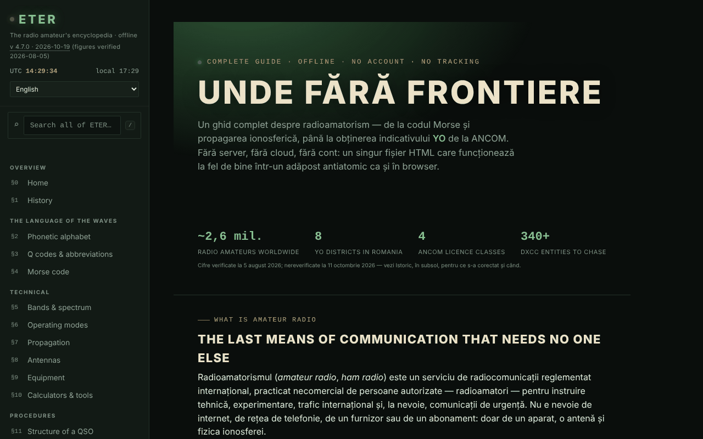

# ETER — The Radio Amateur's Encyclopedia

**English** · [Română](README.ro.md) · [Français](README.fr.md) · [Italiano](README.it.md) · [Español](README.es.md) · [Português](README.pt.md) · [Deutsch](README.de.md) · [Magyar](README.hu.md)

**Version:** 4.7.5 · **Last updated:** 2026-10-22

Interface languages: **Română, English, Français, Italiano, Español, Português (PT), Deutsch, Magyar**

A complete guide to amateur radio in a single HTML file: Q codes, Morse, bands, propagation, antennas, callsigns, ANCOM licensing.

**Live app:** https://chiuta.github.io/ETER/

## What it is

ETER is an interactive amateur radio encyclopedia (the version shown in the app: v4.7.2, updated 2026-10-19; the figures and regulations remain those verified on 2026-08-05), organised in 19 numbered sections §0–§18. The text in the app describes it as "no server, no cloud, no account", and the content is loaded from the same HTML file.

**Languages:** the guide sections (about 400 blocks), the Q codes, the abbreviations, the glossary, the callsign prefixes and the question bank with options and explanations are available in the 8 languages; proper names, callsigns, Q codes and abbreviations as symbols, formulas, Morse symbols, the names of contests/diplomas/services, URLs, and the bodies of the old version-history entries (v1.0–v4.0, in Romanian) remain as they are. The translations are automatic and not verified by native speakers; the "Become a YO radio amateur" section (ANCOM procedure, classes, Decision 245/2017, deadlines, fees), the regulation quiz questions, the emergency/public-service section (ARES/RACES, repeaters, NVIS) and the safety content (antennas/RF, dummy load, maximum power) **need specialist or legal review**.

## Features

Sections (left-hand menu, ☰ on mobile): Home, History, Phonetic alphabet, Q codes & abbreviations, Morse code, Bands & spectrum, Operating modes, Propagation, Antennas, Equipment, Calculators & tools, Structure of a QSO, Callsigns, QSL & station log, Contests & awards, Emergencies & public utility, Become a YO radio amateur, Knowledge test, A–Z glossary.

Tools verified in the code / interface:
- Morse code: text ⇄ Morse translator with audio playback, Morse listener from the microphone (marked experimental), Koch trainer (rounds of 25 characters), sending trainer with a straight key; level export/import.
- Calculators: antenna lengths, Maidenhead locator (with "Use my location"), azimuth and distance (with a live compass and a camera AR overlay, both optional), frequency ⇄ wavelength, S-meter / dB reference.
- Educational simulator of propagation trends, with solar indices (SFI, K-index) explained.
- Knowledge test with spaced repetition; export/import of progress, of identity and of a backup package; generation and verification of an operator certificate (QR code).
- Global search in the left-hand menu (the `/` key, or the "Search all of ETER" field): finds sections, subsection titles, Q codes, abbreviations, glossary terms and DX prefixes, ignores diacritics; Enter opens the first result, the arrow keys navigate the list, Esc clears the field. On mobile `/` opens the menu.
- Day / night mode, printing of the current section, full-screen practice mode, "copy" buttons.
- "Verify file integrity" (SHA-256) and "What the file is made of".
- "Report an error": opens the GitHub Issues form.

## New features (v4.5.0, 14 October 2026)

### Morse listener from the microphone, version 2 (§4)

It remains **experimental**, but now:
- **Tone detection** (default, the "Detect by tone" checkbox): it finds the tone frequency on its own in the 300–1500 Hz band (a narrow peak in the spectrum, tracked as it goes) and measures its amplitude with a Goertzel filter on ~12 ms windows, with a ~2.5 ms step; it ignores broadband noise and speech (the energy must be concentrated in the tone) and uses hysteresis relative to the tone level. With the box unchecked the old method (RMS level against a threshold) is kept.
- **Automatic speed** (the "Automatic speed" checkbox): the time unit (dit) is estimated from the rhythm heard, on local windows of 13 marks, with outliers excluded; the WPM slider remains only a starting point. The code decoding is redone at every new mark, so a wrong start corrects itself. Display: tone frequency, estimated speed (WPM) and number of marks.
- The microphone is requested **without** noise suppression, echo cancellation and automatic gain control (these spoil pure tones); timings are computed from the number of audio samples (ScriptProcessor, fallback: AnalyserNode), not from display frames.
- New buttons: "Clear text" and "Copy text".
- **Real limits:** it is suited to roughly 8–25 WPM, a clean and steady tone, a quiet room. At 30 WPM and above, or with very irregular keying, errors occur. The first marks after starting may be missing while the tone is being "caught" (tens of ms). It does not replace a dedicated hardware/software decoder; under heavy CPU load, audio capture may drop samples. Tested with synthetic audio (5 speeds/frequencies, noise, irregular rhythm) through Chromium's fake audio device, not with real on-air signals.

### Exam mode (§17 Knowledge test)

The "Exam mode" button starts a **practice** simulation: 10, 20 or 30 questions from the existing bank (respecting the category filter), with an **optional time limit** (10, 20 or 30 minutes; the timer is based on a deadline, so it does not freeze when the tab is in the background). It does not show correct/wrong along the way; you can navigate between questions (←/→ arrows or the "Jump to question" buttons), change your answers (keys 1–4) and finish at any time (with confirmation if questions remain unanswered, which are counted as wrong). At the end: score, percentage, breakdown by category and the list of mistakes with explanations. The answers given feed the existing **spaced repetition** (correct/wrong). **The 75% threshold is chosen by the app for practice; it is not the official ANCOM threshold** and the result does not predict the grade in the real exam (for the exam simulator see examenyo.net and the INDICATIV app).

### Transparency and backup (fff-kit)

A click (or Enter) on the displayed version (`v 4.5.0 · 2026-10-14`) opens the "Transparency" window: the declared network hosts (0 external requests), the local storage keys with sizes, the APIs used, the file's size and SHA-256 (with a verifier for a downloaded file) and the **backup** of the app's data into a `.fff.json` file (optionally encrypted with a password, AES-GCM 256 / PBKDF2; the password cannot be recovered), import with confirmation and deletion of the app's data. The kit (`fff-kit`, modules: core, label, bundle) is embedded in `index.html`, makes no network requests and does not change existing data; without it the app works the same. ETER does not write to `localStorage` itself; the kit's backup file will contain only any keys that the kit or a future version might create. Test progress, the Koch level and identity continue to be saved through the app's own exports. The kit's texts are in 8 languages (ro, en, fr, it, es, pt, hu, de); **the fr/it/es/pt/hu/de translations are automatic and not verified by native speakers**. The app's own interface and content are also available in the 8 languages (see the language note near the top); the content translations are automatic and not verified by native speakers.

## User guide

1. Open the page and choose a section from the left-hand menu (on mobile press ☰).
2. Switch between ☾ Night and ☀ Day from the menu.
3. For Morse: in §4 type a text in the translator and press "Play audio" ("Stop" stops it); for the trainer press "Start a round" and "Check". The level is saved with "Export level" and restored with "Import level".
4. For the locator: in §10 press "Calculate locator" (or "Use my location", which asks for the browser's permission).
5. In §17 take the test; with "Export progress" / "Import progress" you keep results between sessions.
6. Also in §17 you can generate an operator certificate and verify it later; "Export identity" saves the local identity to a file.
7. "Print current section" prints the displayed section; "Report an error" opens GitHub Issues.

## Privacy and network

- Local: I found no use of `localStorage`, `sessionStorage` or IndexedDB in the code. Progress, level and identity are kept only through file export/import.
- Network: the text in the app states that nothing is loaded from the internet, and in the code I found no external scripts or resources. The only `fetch` calls are to its own file (`location.href`), only when the page is served by URL, for "Verify file integrity" and "What the file is made of".
- External links (ANCOM, QRZ, radioamator.ro, hamradio.ro, IARU R1, examenyo.net, GitHub, trom.tf etc.) open only if you click them.
- Features that ask for browser permissions, only on your action: microphone (Morse listener), location, compass/orientation and camera (AR overlay, QR code scanning), speech synthesis.
- The page has a strict CSP policy (`default-src 'none'`; scripts are allowed only by SHA-256 hash, without `'unsafe-inline'`; no connections to other domains; only `self`, `data:` and `blob:`).
- The app includes libraries with their own licences (e.g. a QR code generator, MIT), embedded in the file.

## Local / offline use

Download `index.html` and open it in a browser. Almost everything works without internet. "Verify file integrity" and "What the file is made of" work when the file is served by URL (e.g. GitHub Pages); from `file://` (opened from disk) the browser does not allow `fetch`, so the app asks you to choose the `index.html` file from disk and reads it only locally (no network). Note: the chosen file is verified, not necessarily the page currently open.

## Licence

MIT — see the `LICENSE` file. © 2026 Alexandru-Ionuț Chiuță (Alexio). The third-party libraries included in the file keep their own licences (e.g. the QR code generator by Kazuhiko Arase, MIT).

## Author

Alexio — Alexandru-Ionuț Chiuță, contact: alexio@trom.tf

## English summary

ETER is a single-file 8-language amateur radio encyclopedia (19 sections: Morse trainers, Q codes, bands, propagation, antennas, callsigns, ANCOM licensing, calculators, quiz with spaced repetition). It uses no browser storage (progress is exported/imported as files) and loads no external resources; external links open only on click. The integrity check fetches its own file, so it works only over a URL.

## Audit

Audit: 2026-10-10 — verified: 0 JS errors; the only `fetch` calls are to its own file (`location.href`); there is no `localStorage`/`sessionStorage`/IndexedDB in the code, as the README states. Corrected the contrast of the "muted" colours (night and day themes). The app has no CSP meta. The ANCOM exam content is an educational summary that refers to ANCOM Decision no. 245/2017 as the official source; the generated certificates/micro-credentials are not recognised by ANCOM or by any authority (stated in the app, §17).

## History / Changelog

### 4.7.5 — 2026-10-22

fff-kit 1.1.2: PBKDF2 with 600,000 iterations, anti-clickjacking protection.

- 4.7.4 — 2026-10-22: Mobile: all text raised to at least 12 px (it was 10-11.5 px in 150+ places); footer links and the "older versions" toggles have a larger tap area.
- 4.7.3 — 2026-10-22: **fix**: the author link in the footer (TROM — trade-free project) is now translated in every language.
### 2026-10-19 (v4.7.1)
- All the long content (about 400 guide blocks, Q codes, abbreviations, glossary, prefixes, the 82 quiz questions with explanations) translated into en, fr, it, es, pt, de, hu; the app's interface is no longer only Romanian. Fix: long German words no longer overflow the headings at 390 px.

### 19 October 2026 (v4.6.0)
- The address `#sec=<id>[&from=<slug>]` opens a section of the encyclopedia directly (another id, `quiz` and `morse` are ignored); links (new tab) to Alphabets in the "Phonetic alphabet" and "Morse code" sections. No change to regulatory content.

### 14 October 2026 (v4.5.0)
- Morse listener v2: tone detection (Goertzel), automatic speed, microphone without voice processing, Clear/Copy buttons; exam mode in the Knowledge test; fff-kit (Transparency + backup). Regulatory content did not change.

### 12 October 2026 (v4.4.1)
- 4.4.1 — 2026-10-12: the version and the date of the last update are shown in the app
- The ANCOM content was neither modified nor re-verified.

### 11 October 2026 (v4.4)
- The prefix `YO / YP / YQ / YR` (Romania) was added to the prefix list (searching "YO" gave 0 results); the prefix search also accepts a full callsign (e.g. `YO3AIC` → `YO`).
- "Verify file integrity" and "What the file is made of" also work from `file://`: you choose the file from disk, and the SHA-256 is computed locally; `fetch` from `file://` is no longer attempted, so the console error no longer appears.
- The ANCOM content was neither modified nor re-verified.

### 11 October 2026 (v4.3)
- Global search in the menu (the `/` key): sections, titles, Q codes, abbreviations, glossary, prefixes.
- CSP: `script-src` on SHA-256 hash for the three scripts, instead of `'unsafe-inline'`.
- The ANCOM content was neither modified nor re-verified.

### 11 October 2026 (v4.2)
- The mobile bar is now a `header` landmark; the main heading (h1) exists on all sections, and the headings in the footer are h2 (axe: 0 violations, all sections checked at 1280 and 360 px).
- The labels of scrollable tables are unique (landmark-unique).
- Added a strict CSP (`default-src 'none'`).
- The ANCOM content (figures, exam sessions, Decision 245/2017) was NOT re-verified on 11.10.2026: it remains explicitly marked "verified on 2026-08-05"; check ancom.ro.
