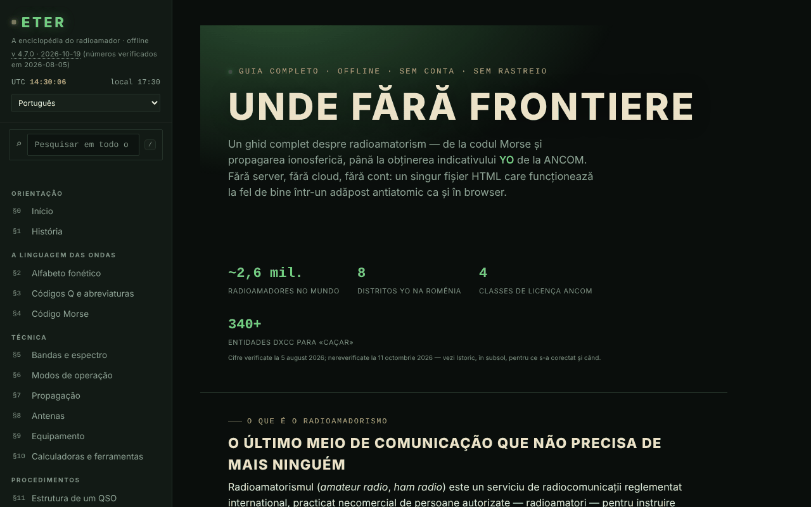

# ETER — A enciclopédia do radioamador

[English](README.md) · [Română](README.ro.md) · [Français](README.fr.md) · [Italiano](README.it.md) · [Español](README.es.md) · **Português** · [Deutsch](README.de.md) · [Magyar](README.hu.md)

**Versão:** 5.1.0 · **Última atualização:** 2026-10-27

**Estado:** estável · **Offline:** completo

Idiomas da interface: **Română, English, Français, Italiano, Español, Português (PT), Deutsch, Magyar**

Guia completo do radioamadorismo num único ficheiro HTML: códigos Q, Morse, bandas, propagação, antenas, indicativos, licenciamento ANCOM.

**Aplicação online:** https://chiuta.github.io/ETER/

## O que é

O ETER é uma enciclopédia interativa do radioamador (versão apresentada na aplicação: v4.7.2, atualizada em 2026-10-19; os números e os regulamentos continuam a ser os verificados a 2026-08-05), organizada em 19 secções numeradas §0–§18. O texto da aplicação descreve-a como «sem servidor, sem nuvem, sem conta», e o conteúdo é carregado a partir do mesmo ficheiro HTML.

**Idiomas:** as secções do guia (cerca de 400 blocos), os códigos Q, as abreviaturas, o glossário, os prefixos de indicativos e o banco de perguntas com opções e explicações estão disponíveis nos 8 idiomas; os nomes próprios, os indicativos, os códigos Q e abreviaturas como símbolos, as fórmulas, os símbolos Morse, os nomes de concursos/diplomas/serviços, os URL e o corpo das entradas antigas do histórico (v1.0–v4.0, em romeno) permanecem inalterados. As traduções são automáticas, não verificadas por falantes nativos; a secção «Torna-te radioamador YO» (procedimento ANCOM, classes, Decisão 245/2017, prazos, taxas), as perguntas do questionário sobre regulamentação, a secção de emergências e utilidade pública (ARES/RACES, repetidores, NVIS) e o conteúdo de segurança (antenas/RF, carga fictícia, potência máxima) **precisam de revisão especializada ou jurídica**.

## Funcionalidades

Secções (menu da esquerda, ☰ no telemóvel): Início, História, Alfabeto fonético, Códigos Q e abreviaturas, Código Morse, Bandas e espetro, Modos de operação, Propagação, Antenas, Equipamentos, Calculadoras e ferramentas, Estrutura de um QSO, Indicativos de chamada, QSL e diário de tráfego, Concursos e diplomas, Emergências e utilidade pública, Torna-te radioamador YO, Teste de conhecimentos, Glossário A–Z.

Ferramentas verificadas no código / na interface:
- Código Morse: tradutor texto ⇄ Morse com reprodução de áudio, escuta de Morse a partir do microfone (assinalada como experimental), treinador Koch (rondas de 25 caracteres), treinador de envio com manipulador simples; exportação/importação do nível.
- Calculadoras: comprimentos de antena, locator Maidenhead (com «Usar a minha localização»), azimute e distância (com bússola em direto e sobreposição AR da câmara, ambas opcionais), frequência ⇄ comprimento de onda, referência S-meter / dB.
- Simulador didático de tendências de propagação, com explicação dos índices solares (SFI, índice K).
- Teste de conhecimentos com repetição espaçada; exportação/importação do progresso, da identidade e de um pacote de reserva; geração e verificação de um certificado de operador (código QR).
- Pesquisa global no menu da esquerda (tecla `/`, ou o campo «Pesquisar em todo o ETER»): encontra secções, títulos de subsecções, códigos Q, abreviaturas, termos do glossário e prefixos DX, ignora os diacríticos; Enter abre o primeiro resultado, as setas percorrem a lista, Esc esvazia o campo. No telemóvel, `/` abre o menu.
- Modo dia / noite, impressão da secção atual, modo de treino em ecrã inteiro, botões «copiar».
- «Verificar a integridade do ficheiro» (SHA-256) e «De que é feito o ficheiro».
- «Comunicar um erro»: abre o formulário do GitHub Issues.

## Novidades (v4.5.0, 14 de outubro de 2026)

### Escuta de Morse a partir do microfone, versão 2 (§4)

Continua **experimental**, mas agora:
- **Deteção de tom** (por predefinição, caixa «Deteção por tom»): encontra por si só a frequência do tom na banda de 300–1500 Hz (um pico estreito no espetro, acompanhado ao longo do tempo) e mede a sua amplitude com um filtro de Goertzel em janelas de ~12 ms, com passo de ~2,5 ms; ignora o ruído de banda larga e a fala (a energia tem de estar concentrada no tom) e usa histerese relativamente ao nível do tom. Com a caixa desmarcada mantém-se o método antigo (nível RMS face a um limiar).
- **Velocidade automática** (caixa «Velocidade automática»): a unidade de tempo (o ponto) é estimada a partir do ritmo ouvido, em janelas locais de 13 sinais, excluindo os valores atípicos; o cursor de WPM fica apenas como ponto de partida. A descodificação do código é refeita a cada novo sinal, pelo que um início errado se corrige sozinho. Apresentação: frequência do tom, velocidade estimada (WPM) e número de sinais.
- O microfone é pedido **sem** supressão de ruído, cancelamento de eco e controlo automático de ganho (que estragam os tons puros); os tempos são calculados a partir do número de amostras de áudio (ScriptProcessor, alternativa: AnalyserNode), e não a partir das imagens de apresentação.
- Botões novos: «Apagar o texto» e «Copiar o texto».
- **Limites reais:** adequa-se a cerca de 8–25 WPM, com um tom limpo e constante, numa sala silenciosa. A 30 WPM ou mais, ou com uma manipulação muito irregular, surgem erros. Os primeiros sinais após o arranque podem faltar enquanto o tom é «apanhado» (dezenas de ms). Não substitui um descodificador dedicado de hardware/software; com forte carga do processador, a captura de áudio pode perder amostras. Testado com áudio sintético (5 velocidades/frequências, ruído, ritmo irregular) através do dispositivo de áudio falso do Chromium, não com emissões reais no ar.

### Modo exame (§17 Teste de conhecimentos)

O botão «Modo exame» inicia uma simulação de **treino**: 10, 20 ou 30 perguntas do banco existente (respeitando o filtro de categoria), com um **limite de tempo opcional** (10, 20 ou 30 minutos; o cronómetro baseia-se num prazo, pelo que não congela com o separador em segundo plano). Não mostra certo/errado pelo caminho; podes navegar entre as perguntas (setas ←/→ ou os botões «Saltar para a pergunta»), alterar as respostas (teclas 1–4) e terminar a qualquer momento (com confirmação se restarem perguntas sem resposta, que contam como erradas). No fim: pontuação, percentagem, detalhe por categorias e lista dos erros com explicações. As respostas dadas alimentam a **repetição espaçada** existente (certo/errado). **O limiar de 75% é escolhido pela aplicação para treino; não é o limiar oficial da ANCOM** e o resultado não prevê a nota no exame real (para o simulador de exame ver examenyo.net e a aplicação INDICATIV).

### Transparência e cópia de segurança (fff-kit)

Um clique (ou Enter) na versão apresentada (`v 4.5.0 · 2026-10-14`) abre a janela «Transparência»: os anfitriões de rede declarados (0 pedidos externos), as chaves de armazenamento local com os tamanhos, as API utilizadas, o tamanho e o SHA-256 do ficheiro (com um verificador para um ficheiro descarregado) e a **cópia de segurança** dos dados da aplicação num ficheiro `.fff.json` (opcionalmente cifrado com palavra-passe, AES-GCM 256 / PBKDF2; a palavra-passe não pode ser recuperada), a importação com confirmação e a eliminação dos dados da aplicação. O kit (`fff-kit`, módulos: core, label, bundle) está integrado em `index.html`, não faz pedidos de rede e não altera os dados existentes; sem ele, a aplicação funciona da mesma forma. O ETER não escreve por si próprio em `localStorage`; o ficheiro de cópia de segurança do kit conterá apenas as eventuais chaves que o kit ou uma versão futura venha a criar. O progresso do teste, o nível Koch e a identidade continuam a ser guardados através das exportações próprias da aplicação. Os textos do kit estão em 8 línguas (ro, en, fr, it, es, pt, hu, de); **as traduções fr/it/es/pt/hu/de são automáticas e não foram verificadas por falantes nativos**. A interface e o conteúdo da aplicação também estão disponíveis nos 8 idiomas (ver a nota sobre idiomas no início); as traduções do conteúdo são automáticas, não verificadas por falantes nativos.

## Guia de utilização

1. Abre a página e escolhe uma secção no menu da esquerda (no telemóvel prime ☰).
2. Alterna entre ☾ Noite e ☀ Dia a partir do menu.
3. Para o Morse: no §4 escreve um texto no tradutor e prime «Reproduzir áudio» («Stop» pára); para o treinador prime «Iniciar uma ronda» e «Verificar». O nível guarda-se com «Exportar o nível» e retoma-se com «Importar o nível».
4. Para o locator: no §10 prime «Calcular o locator» (ou «Usar a minha localização», que pede a permissão do navegador).
5. No §17 resolve o teste; com «Exportar o progresso» / «Importar o progresso» manténs os resultados entre sessões.
6. Também no §17 podes gerar um certificado de operador e verificá-lo mais tarde; «Exportar a identidade» guarda a identidade local num ficheiro.
7. «Imprimir a secção atual» imprime a secção apresentada; «Comunicar um erro» abre o GitHub Issues.

## Privacidade e rede

- Local: não encontrei qualquer utilização de `localStorage`, `sessionStorage` ou IndexedDB no código. O progresso, o nível e a identidade só se guardam através de exportação/importação de ficheiros.
- Rede: o texto da aplicação afirma que nada é carregado da internet, e no código não encontrei scripts nem recursos externos. As únicas chamadas `fetch` são ao próprio ficheiro (`location.href`), apenas quando a página é servida por URL, para «Verificar a integridade do ficheiro» e «De que é feito o ficheiro».
- As ligações externas (ANCOM, QRZ, radioamator.ro, hamradio.ro, IARU R1, examenyo.net, GitHub, trom.tf, etc.) só se abrem se clicares nelas.
- Funcionalidades que pedem permissões do navegador, apenas por ação tua: microfone (escuta de Morse), localização, bússola/orientação e câmara (sobreposição AR, leitura de códigos QR), síntese de voz.
- A página tem uma política CSP rigorosa (`default-src 'none'`; os scripts só são permitidos por hash SHA-256, sem `'unsafe-inline'`; sem ligações a outros domínios; apenas `self`, `data:` e `blob:`).
- A aplicação inclui bibliotecas com licenças próprias (por exemplo um gerador de códigos QR, MIT), integradas no ficheiro.

## Execução local / offline

Descarrega `index.html` e abre-o num navegador. Quase tudo funciona sem internet. «Verificar a integridade do ficheiro» e «De que é feito o ficheiro» funcionam quando o ficheiro é servido por URL (por exemplo GitHub Pages); a partir de `file://` (aberto a partir do disco) o navegador não permite `fetch`, pelo que a aplicação pede-te que escolhas o ficheiro `index.html` do disco e lê-o apenas localmente (sem rede). Atenção: é verificado o ficheiro escolhido, não necessariamente a página aberta neste momento.

## Licença

MIT — ver o ficheiro `LICENSE`. © 2026 Alexandru-Ionuț Chiuță (Alexio). As bibliotecas de terceiros incluídas no ficheiro mantêm as suas próprias licenças (por exemplo o gerador de códigos QR de Kazuhiko Arase, MIT).

## Autor

Alexio — Alexandru-Ionuț Chiuță, contacto: alexio@trom.tf

## Resumo

O ETER é uma enciclopédia de radioamadorismo em 8 idiomas, num único ficheiro (19 secções: treinadores de Morse, códigos Q, bandas, propagação, antenas, indicativos, licenciamento ANCOM, calculadoras, questionário com repetição espaçada). Não usa armazenamento do navegador (o progresso é exportado/importado como ficheiros) e não carrega recursos externos; as ligações externas abrem apenas ao clicar. A verificação de integridade obtém o seu próprio ficheiro, pelo que só funciona através de um URL.

## Auditoria

Auditoria: 2026-10-10 — verificado: 0 erros de JS; os únicos `fetch` são ao próprio ficheiro (`location.href`); não existe `localStorage`/`sessionStorage`/IndexedDB no código, como afirma o README. Corrigido o contraste das cores «esbatidas» (temas noite e dia). A aplicação não tem meta CSP. O conteúdo sobre o exame da ANCOM é um resumo didático que remete para a Decisão da ANCOM n.º 245/2017 como fonte oficial; os certificados/microcredenciais gerados não são reconhecidos pela ANCOM nem por qualquer autoridade (precisado na aplicação, §17).

## Histórico / Changelog

### 4.7.6 — 2026-10-22

fff-kit 1.1.4: áreas de toque e texto mínimo. Áreas de toque/texto corrigidos na aplicação.

### 4.7.5 — 2026-10-22

fff-kit 1.1.2: PBKDF2 com 600.000 iterações, proteção anti-clickjacking.

- 4.7.4 — 2026-10-22: Telemóvel: todo o texto passa a um mínimo de 12 px (estava a 10-11,5 px em mais de 150 locais); as ligações do rodapé e os interruptores «versões anteriores» têm uma área de toque maior.
- 4.7.3 — 2026-10-22: **correção**: a ligação do autor no rodapé (TROM — projeto trade-free) já está traduzida em todos os idiomas.
### 2026-10-19 (v4.7.1)
- Todo o conteúdo longo (cerca de 400 blocos de guia, códigos Q, abreviaturas, glossário, prefixos, as 82 perguntas do questionário com explicações) está traduzido para en, fr, it, es, pt, de, hu; a interface da aplicação já não é só em romeno. Corrigido: as palavras alemãs longas já não transbordam dos títulos a 390 px.

### 19 de outubro de 2026 (v4.6.0)
- O endereço `#sec=<id>[&from=<slug>]` abre diretamente uma secção da enciclopédia (outro id, `quiz` e `morse` são ignorados); ligações (novo separador) para Alfabete nas secções «Alfabeto fonético» e «Código Morse». Nenhuma alteração ao conteúdo regulamentar.

### 14 de outubro de 2026 (v4.5.0)
- Escuta de Morse v2: deteção de tom (Goertzel), velocidade automática, microfone sem processamento de voz, botões Apagar/Copiar; modo exame no Teste de conhecimentos; fff-kit (Transparência + cópia de segurança). O conteúdo regulamentar não mudou.

### 12 de outubro de 2026 (v4.4.1)
- 4.4.1 — 2026-10-12: a versão e a data da última atualização são apresentadas na aplicação
- O conteúdo da ANCOM não foi alterado nem reverificado.

### 11 de outubro de 2026 (v4.4)
- O prefixo `YO / YP / YQ / YR` (Roménia) foi acrescentado à lista de prefixos (a pesquisa de «YO» dava 0 resultados); a pesquisa de prefixos aceita também um indicativo completo (p. ex. `YO3AIC` → `YO`).
- «Verificar a integridade do ficheiro» e «De que é feito o ficheiro» funcionam também a partir de `file://`: escolhes o ficheiro do disco e o SHA-256 é calculado localmente; deixa de se fazer `fetch` a partir de `file://`, pelo que o erro na consola deixa de aparecer.
- O conteúdo da ANCOM não foi alterado nem reverificado.

### 11 de outubro de 2026 (v4.3)
- Pesquisa global no menu (tecla `/`): secções, títulos, códigos Q, abreviaturas, glossário, prefixos.
- CSP: `script-src` por hash SHA-256 para os três scripts, em vez de `'unsafe-inline'`.
- O conteúdo da ANCOM não foi alterado nem reverificado.

### 11 de outubro de 2026 (v4.2)
- A barra móvel é agora um ponto de referência `header`; o título principal (h1) existe em todas as secções, e os títulos do rodapé são h2 (axe: 0 violações, todas as secções verificadas a 1280 e 360 px).
- As etiquetas das tabelas deslizantes são únicas (landmark-unique).
- Adicionada uma CSP rigorosa (`default-src 'none'`).
- O conteúdo da ANCOM (números, sessões de exame, Decisão 245/2017) NÃO foi reverificado a 11.10.2026: continua expressamente assinalado como «verificado a 2026-08-05»; confirma em ancom.ro.
