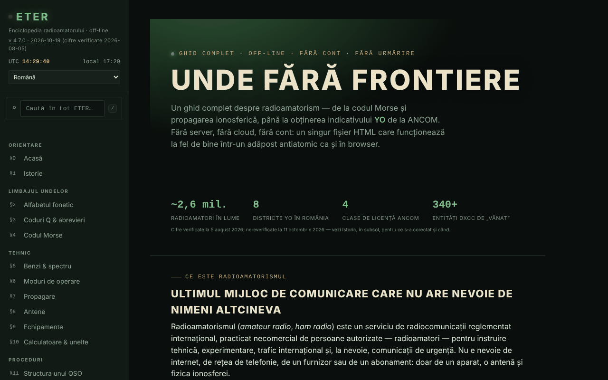

# ETER — Enciclopedia radioamatorului

[English](README.md) · **Română** · [Français](README.fr.md) · [Italiano](README.it.md) · [Español](README.es.md) · [Português](README.pt.md) · [Deutsch](README.de.md) · [Magyar](README.hu.md)

**Versiune:** 4.7.0 · **Ultima actualizare:** 2026-10-19

Limbile interfeței: **Română, English, Français, Italiano, Español, Português (PT), Deutsch, Magyar**

Ghid complet despre radioamatorism, într-un singur fișier HTML: coduri Q, Morse, benzi, propagare, antene, indicative, licențiere ANCOM.

**Live:** https://chiuta.github.io/ETER/

## Ce este

ETER este o enciclopedie interactivă a radioamatorului (versiunea afișată în aplicație: v4.4.1, actualizată 2026-10-12; cifrele și regulamentele rămân cele verificate la 2026-08-05), organizată în 19 secțiuni numerotate §0–§18. Textul din aplicație o descrie ca „fără server, fără cloud, fără cont", iar conținutul se încarcă din același fișier HTML.

## Funcții

Secțiuni (meniul din stânga, ☰ pe mobil): Acasă, Istorie, Alfabetul fonetic, Coduri Q & abrevieri, Codul Morse, Benzi & spectru, Moduri de operare, Propagare, Antene, Echipamente, Calculatoare & unelte, Structura unui QSO, Indicative de apel, QSL & jurnal de trafic, Concursuri & diplome, Urgențe & utilitate publică, Devino radioamator YO, Test cunoștințe, Glosar A–Z.

Unelte verificate în cod / interfață:
- Codul Morse: traducător text ⇄ Morse cu redare audio, ascultător Morse din microfon (marcat experimental), antrenor Koch (runde de 25 de caractere), antrenor de trimitere cu tastă simplă; export/import de nivel.
- Calculatoare: lungimi de antenă, locator Maidenhead (cu „Folosește locația mea"), azimut și distanță (cu busolă live și overlay de cameră AR, opționale), frecvență ⇄ lungime de undă, referință S-metru / dB.
- Simulator didactic de tendințe de propagare și indicatori solari (SFI, K-index) explicați.
- Test de cunoștințe cu repetiție spațiată; exportul/importul progresului, al identității și al unui pachet de rezervă; generare și verificare de certificat de operator (cod QR).
- Căutare globală în meniul din stânga (tasta `/`, sau câmpul „Caută în tot ETER”): găsește secțiuni, titluri de subsecțiuni, coduri Q, abrevieri, termeni din glosar și prefixe DX, ignoră diacriticele; Enter deschide primul rezultat, săgețile navighează lista, Esc golește câmpul. Pe mobil `/` deschide meniul.
- Mod zi / noapte, printarea secțiunii curente, mod exersare pe ecran complet, butoane „copiază".
- „Verifică integritatea fișierului" (SHA-256) și „Din ce e făcut fișierul".
- „Raportează o eroare": deschide formularul GitHub Issues.

## Funcții noi (v4.5.0, 14 octombrie 2026)

### Ascultător Morse din microfon, versiunea 2 (§4)

Rămâne **experimental**, dar acum:
- **Detecție de ton** (implicit, căsuța „Detectare după ton”): caută singur frecvența tonului în banda 300–1500 Hz (vârf îngust în spectru, urmărit pe parcurs) și măsoară amplitudinea lui cu un filtru Goertzel pe ferestre de ~12 ms, cu pas de ~2,5 ms; ignoră zgomotul larg și vorbirea (energia trebuie să fie concentrată în ton) și folosește histerezis față de nivelul tonului. Cu căsuța debifată se păstrează metoda veche (nivel RMS față de prag).
- **Viteză automată** (căsuța „Viteză automată”): unitatea de timp (dit) se estimează din ritmul auzit, pe ferestre locale de 13 semne, cu valori aberante excluse; cursorul WPM rămâne doar punct de plecare. Deducerea codului se refăcut la fiecare semn nou, deci un început greșit se corectează singur. Afișaj: frecvența tonului, viteza estimată (WPM) și numărul de semne.
- Microfonul se cere **fără** suprimare de zgomot, anulare de ecou și control automat al câștigului (acestea strică tonurile pure); timpii se calculează din numărul de eșantioane audio (ScriptProcessor, rezervă: AnalyserNode), nu din cadrele de afișare.
- Butoane noi: „Șterge textul” și „Copiază textul”.
- **Limite reale:** se potrivește pentru aproximativ 8–25 WPM, ton curat și constant, cameră liniștită. La 30 WPM și peste, sau cu manipulare foarte neregulată, apar erori. Primele semne după pornire pot lipsi cât timp se „prinde” tonul (zeci de ms). Nu înlocuiește un decodor hardware/software dedicat; sub încărcare mare a procesorului, înregistrarea audio poate pierde eșantioane. Testat cu audio sintetic (5 viteze/frecvențe, zgomot, ritm neregulat) prin dispozitivul audio fals al Chromium, nu cu emisiuni reale în eter.

### Mod examen (§17 Test de cunoștințe)

Butonul „Mod examen” pornește o simulare de **exersare**: 10, 20 sau 30 de întrebări din banca existentă (respectă filtrul de categorie), cu **limită de timp opțională** (10, 20 sau 30 minute; cronometrul se bazează pe un termen, deci nu îngheață cu fila în fundal). Nu arată corect/greșit pe parcurs; poți naviga între întrebări (săgeți ←/→ sau butoanele „Sari la întrebare”), schimba răspunsurile (tastele 1–4) și termina oricând (cu confirmare dacă rămân întrebări fără răspuns, care se numără ca greșite). La final: scor, procent, detaliu pe categorii și lista greșelilor cu explicații. Răspunsurile date alimentează **repetiția spațiată** existentă (corect/greșit). **Pragul de 75% este ales de aplicație pentru exersare; nu este pragul oficial ANCOM** și rezultatul nu prezice nota la examenul real (pentru simulatorul de examen vezi examenyo.net și aplicația INDICATIV).

### Transparență și copie de siguranță (fff-kit)

Un clic (sau Enter) pe versiunea afișată (`v 4.5.0 · 2026-10-14`) deschide fereastra „Transparență”: gazdele de rețea declarate (0 cereri externe), cheile de stocare locală cu dimensiuni, API-urile folosite, mărimea și SHA-256 al fișierului (cu verificator pentru un fișier descărcat) și **copia de siguranță** a datelor aplicației într-un fișier `.fff.json` (opțional criptat cu parolă, AES-GCM 256 / PBKDF2; parola nu poate fi recuperată), import cu confirmare și ștergerea datelor aplicației. Kitul (`fff-kit`, module: core, label, bundle) este lipit în `index.html`, nu face cereri de rețea și nu schimbă datele existente; fără el aplicația funcționează la fel. ETER nu scrie singur în `localStorage`; fișierul de copie de siguranță al kitului va conține doar eventualele chei pe care le-ar crea kitul sau o versiune viitoare. Progresul testului, nivelul Koch și identitatea se salvează în continuare prin exporturile proprii ale aplicației. Textele kitului sunt în 8 limbi (ro, en, fr, it, es, pt, hu, de); **traducerile fr/it/es/pt/hu/de sunt automate și neverificate nativ**. Interfața aplicației însăși rămâne în română.

## Manual de utilizare

1. Deschide pagina și alege o secțiune din meniul din stânga (pe mobil apasă ☰).
2. Comută între ☾ Noapte și ☀ Zi din meniu.
3. Pentru Morse: în §4 scrie un text în traducător și apasă „Redă audio" („Stop" oprește); pentru antrenor apasă „Începe o rundă" și „Verifică". Nivelul se salvează cu „Exportă nivelul" și se reia cu „Importă nivelul".
4. Pentru locator: în §10 apasă „Calculează locatorul" (sau „Folosește locația mea", care cere permisiunea browserului).
5. În §17 rezolvă testul; cu „Exportă progresul" / „Importă progresul" păstrezi rezultatele între sesiuni.
6. Tot în §17 poți genera un certificat de operator și îl poți verifica ulterior; „Exportă identitatea" salvează identitatea locală într-un fișier.
7. „Printează secțiunea curentă" tipărește secțiunea afișată; „Raportează o eroare" deschide GitHub Issues.

## Confidențialitate și rețea

- Local: nu am găsit utilizare de `localStorage`, `sessionStorage` sau IndexedDB în cod. Progresul, nivelul și identitatea se păstrează doar prin export/import de fișiere.
- Rețea: textul din aplicație afirmă că nimic nu se încarcă de pe internet, iar în cod nu am găsit scripturi sau resurse externe. Singurele apeluri `fetch` sunt către propriul fișier (`location.href`), doar când pagina e servită prin URL, pentru „Verifică integritatea fișierului" și „Din ce e făcut fișierul".
- Linkurile externe (ANCOM, QRZ, radioamator.ro, hamradio.ro, IARU R1, examenyo.net, GitHub, trom.tf etc.) se deschid doar dacă le apeși.
- Funcții care cer permisiuni ale browserului, numai la acțiunea ta: microfon (ascultător Morse), locație, busolă/orientare și cameră (overlay AR, scanare cod QR), sinteză vocală.
- Pagina are o politică CSP strictă (`default-src 'none'`; scripturile sunt permise doar pe hash SHA-256, fără `'unsafe-inline'`; fără conexiuni către alte domenii; doar `self`, `data:` și `blob:`).
- Aplicația include biblioteci cu licențe proprii (de exemplu generator de coduri QR, MIT), integrate în fișier.

## Rulare locală / offline

Descarcă `index.html` și deschide-l în browser. Aproape totul funcționează fără internet. „Verifică integritatea fișierului" și „Din ce e făcut fișierul" funcționează când fișierul este servit prin URL (de exemplu GitHub Pages); din `file://` (deschis de pe disc) browserul nu permite `fetch`, așa că aplicația îți cere să alegi fișierul `index.html` de pe disc și îl citește doar local (fără rețea). Atenție: se verifică fișierul ales, nu neapărat pagina deschisă acum.

## Licență

MIT — vezi fișierul `LICENSE`. © 2026 Alexandru-Ionuț Chiuță (Alexio). Bibliotecile terțe incluse în fișier își păstrează licențele proprii (de exemplu generatorul de coduri QR de Kazuhiko Arase, MIT).

## Autor

Alexio — Alexandru-Ionuț Chiuță, contact: alexio@trom.tf

## English summary

ETER is a single-file Romanian-language amateur radio encyclopedia (19 sections: Morse trainers, Q codes, bands, propagation, antennas, callsigns, ANCOM licensing, calculators, quiz with spaced repetition). It uses no browser storage (progress is exported/imported as files) and loads no external resources; external links open only on click. The integrity check fetches its own file, so it works only over a URL.

## Audit

Audit: 2026-10-10 — verificat: 0 erori JS; singurele `fetch` sunt către propriul fișier (`location.href`); nu există `localStorage`/`sessionStorage`/IndexedDB în cod, cum afirmă README. Corectat contrastul culorilor „estompate” (tema de noapte și cea de zi). Aplicația nu are meta CSP. Conținutul despre examenul ANCOM este un rezumat didactic care trimite la Decizia ANCOM nr. 245/2017 ca sursă oficială; certificatele/microcredențialele generate nu sunt recunoscute de ANCOM sau de vreo autoritate (precizat în aplicație, §17).

## Istoric / Changelog

### 19 octombrie 2026 (v4.6.0)
- Adresa `#sec=<id>[&from=<slug>]` deschide direct o secțiune a enciclopediei (alt id, `quiz` și `morse` se ignoră); linkuri (filă nouă) spre Alfabete în secțiunile „Alfabetul fonetic” și „Codul Morse”. Nicio schimbare de conținut de reglementare.

### 14 octombrie 2026 (v4.5.0)
- Ascultător Morse v2: detecție de ton (Goertzel), viteză automată, microfon fără procesare de voce, butoane Șterge/Copiază; mod examen în Test de cunoștințe; kit fff-kit (Transparență + copie de siguranță). Conținutul de reglementare nu s-a schimbat.

### 12 octombrie 2026 (v4.4.1)
- 4.4.1 — 2026-10-12: versiunea și data ultimei actualizări sunt afișate în aplicație
- Conținutul ANCOM nu a fost modificat și nici re-verificat.

### 11 octombrie 2026 (v4.4)
- Prefixul `YO / YP / YQ / YR` (România) a fost adăugat în lista de prefixe (căutarea „YO” dădea 0 rezultate); căutarea de prefixe acceptă și un indicativ întreg (ex. `YO3AIC` → `YO`).
- „Verifică integritatea fișierului” și „Din ce e făcut fișierul” funcționează și din `file://`: alegi fișierul de pe disc, iar SHA-256 se calculează local; nu se mai face `fetch` de pe `file://`, deci nu mai apare eroare în consolă.
- Conținutul ANCOM nu a fost modificat și nici re-verificat.

### 11 octombrie 2026 (v4.3)
- Căutare globală în meniu (tasta `/`): secțiuni, titluri, coduri Q, abrevieri, glosar, prefixe.
- CSP: `script-src` pe hash SHA-256 pentru cele trei scripturi, în locul `'unsafe-inline'`.
- Conținutul ANCOM nu a fost modificat și nici re-verificat.

### 11 octombrie 2026 (v4.2)
- Bara mobilă este acum un reper `header`; titlul principal (h1) există pe toate secțiunile, iar titlurile din subsol sunt h2 (axe: 0 încălcări, toate secțiunile verificate la 1280 și 360 px).
- Etichetele tabelelor derulabile sunt unice (landmark-unique).
- Adăugat CSP strict (`default-src 'none'`).
- Conținutul ANCOM (cifre, sesiuni de examen, Decizia 245/2017) NU a fost re-verificat la 11.10.2026: rămâne marcat explicit „verificat la 2026-08-05”; verifică pe ancom.ro.
